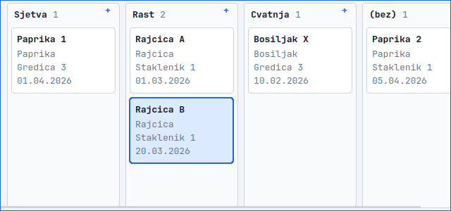
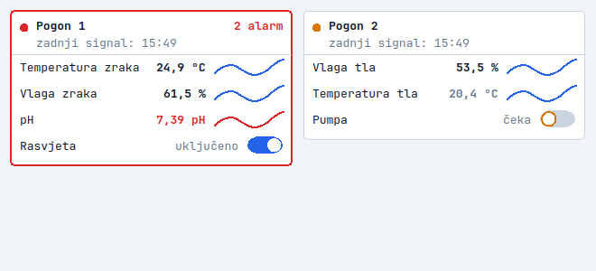
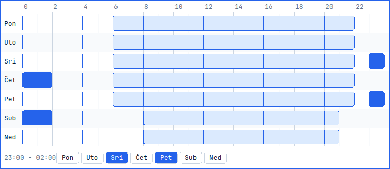
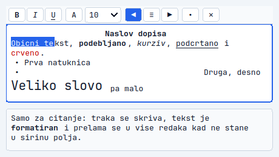

# LightBasePalette — TyphAccess

Repozitorij sadrži **TyphAccess** (graditelj poslovnih aplikacija nad bazom) i **paletu** vlastitih kontrola (LightPalette: paketi u `lazarus/`, izvor u `src/`).

> **Status: alpha (0.1.0-alpha.1).** Radi i ispitan je (smoke testovi, usporedbe snimki, probe mosta s pravim MQTT brokerom i prevođenje ESPHome konfiguracija),
> ali nije prošao ručno ispitivanje cijelog sučelja ni rad u stvarnim pogonima. Izgrađen i isproban samo na **Linuxu (Qt6)**; Windows, macOS i GTK3 nisu ispitani.
> Datoteke baze i oblik definicija mogu se mijenjati bez najave. **Ne koristi za jedinu kopiju važnih podataka**; radi sigurnosne kopije (Aplikacija → Planer zadataka).
> Fiskalizacija nije dio ovog izdanja.

Licenca: MIT (vidi `LICENSE`); komponente trećih strana u `THIRD-PARTY.md`.

Graditelj poslovnih aplikacija u duhu Microsoft Accessa, na CodeTyphon/Lazarus (Qt6) i Zeosu. Baza: SQLite, PostgreSQL ili MariaDB.
Od tablica, preko formi, upita i izvješća, do gotove aplikacije s izbornikom, korisnicima i pravima. Uz to 4GL (Informix-stil) i PascalScript moduli.

Korisnička dokumentacija je **priručnik** ugrađen u program (*Pomoć → Priručnik*, F1); izvor je u `docs/manual/`. Plan rada: `docs/PLAN.md`.

## Kako izgleda

Vlastite kontrole crtaju se same, pa izgledaju isto na Qt-u i GTK-u. Snimke dolaze iz testova usporedbe (`tests/own/golden`).

| Kanban ploča | Nadzorna ploča |
|---|---|
|  |  |
| **Tjedni raspored** | **Formatirani tekst** |
|  |  |

## Što treba imati

* **CodeTyphon** (FPC + Lazarus, Qt6 widgetset) s paketima `adLCL`, `pl_ZeosDBO`, `pl_PascalScript`, `pl_FpSpreadsheet`, `pl_RichMemo`;
  izgradnja: `typhonbuild --pcp=$HOME/.typhon64 --ws=qt6 lazarus/typhaccess_core.ctpkg`, zatim `typhaccess_editors.ctpkg`, pa `TyphAccess.ctpr` (ili `tools/build.sh`).
* Python 3 (alati za priručnik, katalog i ikone: `pycairo` za ikone je neobavezan), `pandoc` (priručnik).
* Za primjer *Proizvodni procesi*: `mosquitto` (MQTT broker i alati) za ispitivanje mosta; `esphome` samo ako želiš prevoditi firmware za ESP32.

## Brzi početak: primjer „Proizvodni procesi”

Primjer je cijela aplikacija opisana jednom datotekom (`examples/aplikacije/procesi.opis`): serije po fazama (kanban), radnje, mjerenja, zaliha s prosječnom cijenom,
trošak i cijena po prinosu, pogoni s uređajima (senzori i izlazi), rasporedi (vremenska crta), automatika, alarmi, nadzorna ploča, MQTT most, generator ESPHome konfiguracija i
povezivanje više lokacija. Općenito je: radi za svaku proizvodnju s fazama i mjerenjima.

```
bin/TyphAccess --make-app=examples/aplikacije/procesi.opis Procesi.db
python3 examples/aplikacije/procesi_simulator.py seed Procesi.db      # katalog, 3 pogona s uređajima, zaliha
bin/TyphAccess Procesi.db                                              # Aplikacija → Pokreni početnu formu
```

Plan i protokol: `docs/PLAN-proizvodni-procesi.md`.

## Izgradnja i testovi

```
tools/build.sh                  # gradi bin/TyphAccess (regenerira katalog i priručnik)
tools/smoke.sh                  # smoke test (offscreen); za puni test: cd tests && ./smoke (traje dugo)
tools/pg_test.sh start|stop     # privatni Postgres 17 na portu 5433 (za testove)
tools/maria_test.sh start|stop  # privatni MariaDB 11.8 na portu 3307 (za testove)
```

Zastavice testa: `SMOKE_SKIP_CATALOG=1` (preskoči izgradnju svih domena kataloga), `SMOKE_ONLY_FGL=1` (samo 4GL, priručnik i datoteke, bez poslužitelja).
`QT_QPA_PLATFORM=offscreen` za rad bez zaslona.

## Naredbeni redak

| Zastavica | Što radi |
|---|---|
| `datoteka.db` | otvori bazu |
| `--pg=host:port/baza/korisnik`, `--maria=…` | spoji na poslužitelj |
| `--runtime`, `--design` | pokreni kao aplikaciju / u dizajnu |
| `--run=program.4gl`, `--check=program.4gl`, `--console` | izvedi / provjeri 4GL program |
| `--run-tasks` | izvrši zadatke planera koji su na redu i izađi (za `cron`) |
| `--make-northwind` | napravi demo bazu Northwind |
| `--make-blocks-demo` | napravi primjer aplikacije složene blokovima (mali obrt) |
| `--make-domain=oznaka izlaz.db` | napravi bazu iz domene kataloga |
| `--catalog-doc=datoteka.html` | napiši dokumentaciju kataloga |
| `--screenshots=mapa` | snimke zaslona za priručnik (nad otvorenom bazom) |

Okolina: `TYPHACCESS_FILES` (mapa za slike/datoteke), `TYPHACCESS_CATALOG` (dodatne domene kataloga).

## Priručnik, katalog, snimke

```
python3 tools/manual_src/build_manual.py   # provjerava priručnik prema kodu, vadi primjere u tests/, gradi docs/manual/html
python3 tools/gen_manual.py                # ugrađuje HTML u program (src/gui/ta_manualdata.pas)
tools/screenshots.sh                       # nove snimke zaslona u docs/manual/slike (zatim build_manual.py)
python3 tools/gen_catalog.py               # ugrađuje catalog/*.json u program (src/core/ta_catalogdata.pas)
python3 tools/catalog_src/mkcatalog5.py    # izvorne skripte početnog kataloga (prepisuju catalog/*.json)
```

`build_manual.py` ne prolazi ako se priručnik i kod razilaze (funkcije izraza, kontrole, makro naredbe, događaji, slike). Primjeri funkcija, 4GL programi,
PascalScript moduli iz vodiča, 4GL recepti i recepti „Kako da…” izvode se u smoke testu, pa dokumentacija ne može zastarjeti nezamijećeno.

## Pregled koda

| Mapa | Sadržaj |
|---|---|
| `src/core/` | jezgra bez sučelja: baza i metapodaci, izrazi, izvješća, 4GL, katalog, uvoz/izvoz, revizija, planer, pohrana datoteka |
| `src/gui/` | forme, dizajneri, dijalozi, glavni prozor, snimke zaslona |
| `catalog/` | domene kataloga shema (JSON) — izvor istine |
| `docs/manual/` | priručnik (Markdown), `slike/` snimke zaslona, `html/` generirani HTML |
| `tests/` | `smoke.pas` i podaci koje generira `build_manual.py` (`manual_*`) |
| `tools/` | skripte za izgradnju, test poslužitelje, priručnik, katalog, snimke |
| `examples/` | primjeri (4GL) |
