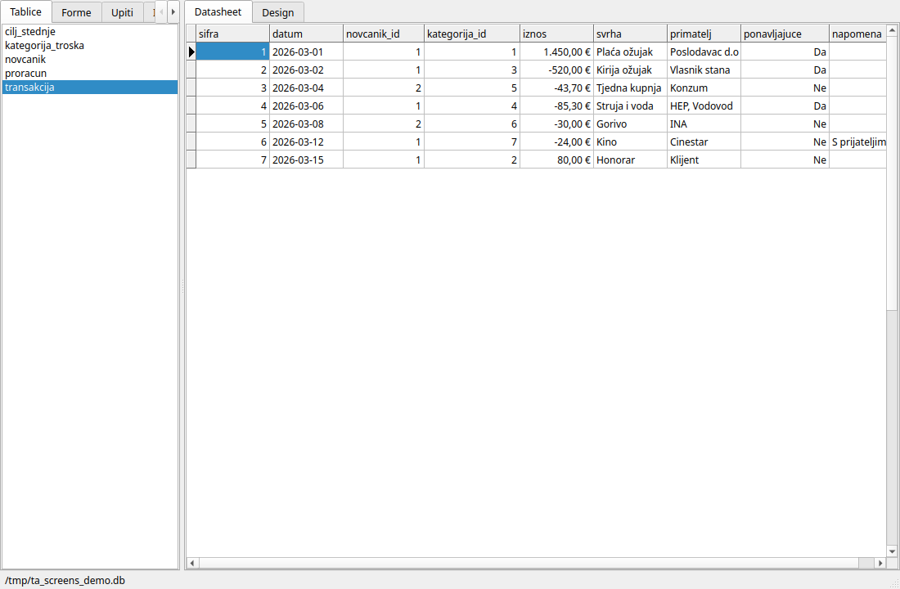

# Uvod

TyphAccess je graditelj poslovnih aplikacija u duhu Microsoft Accessa: od tablica, preko formi, upita i izvješća do gotove aplikacije s izbornikom, korisnicima i pravima. Radi na Linuxu (Qt6), a podatke drži u SQLiteu, Postgresu ili MariaDB-u.



Glavni izbornik nije na slikama (program ga crta sustav), a opisan je u poglavljima.

**Pomoć u programu:** *Pomoć → Priručnik* (F1) otvara cijeli priručnik u pregledniku; *Kako da… (recepti)*, *4GL recepti* i *Poruke i pogreške (FAQ)* otvaraju ga odmah na tom poglavlju. Traženje po riječima: Ctrl+F u pregledniku.

## Što se pravi

| Objekt | Čemu služi | Gdje se nalazi |
|---|---|---|
| **Tablica** | Podaci. Svako polje ima logički tip (tekst, broj, valuta, datum, slika…) koji čuva i format, zadanu vrijednost i opis. | izbornik *Tablica*, kartica *Tablice* |
| **Veza** | Strani ključ između tablica; koristi se za padajuće popise, master–detalj i izvješća. | svojstva polja, *Baza → Relacije* |
| **Forma** | Unos i pregled podataka: jedan zapis, mreža ili obje odjednom; podforme, kartice, gumbi. | izbornik *Forma* |
| **Upit** | Spremljeni SQL (čarobnjak, unakrsni upit, unija), s parametrima. | izbornik *Upit* |
| **Izvješće** | Ispis s grupama, zbrojevima, barkodovima, podizvješćima; pregled, PDF, HTML, pisač. | izbornik *Izvješće* |
| **Makro** | Niz redaka-naredbi (otvori formu, pokreni SQL, ako… onda…). | izbornik *Skripta* |
| **Modul** | Programski kod (PascalScript) s funkcijama koje se mogu zvati iz izraza. | izbornik *Skripta* |

Uz to program nudi: revizijski trag (tko je što promijenio), planer zadataka (sigurnosne kopije, izvozi), uvoz i izvoz (CSV, Excel, JSON), alate za podatke (traži/zamijeni, duplikate), fiskalizaciju i HUB-3 uplatnice, katalog gotovih shema i vlastiti programski jezik **4GL** u stilu Informixa.

## Pokretanje

```
typhaccess                         # dizajn, bez baze
typhaccess baza.db                 # otvori SQLite bazu
typhaccess --runtime baza.db       # samo korištenje (bez alata za dizajn)
typhaccess --design baza.db        # dizajn i kad je baza u runtime načinu
typhaccess --pg=localhost:5432/baza/korisnik         # Postgres (lozinka u PGPASSWORD)
typhaccess --maria=localhost:3306/baza/korisnik      # MariaDB (lozinka u MYSQL_PWD)
typhaccess --run-tasks baza.db     # izvrši zadatke koji su na redu i izađi
typhaccess --make-northwind Northwind.db             # primjer-baza
typhaccess --check=app.4gl         # provjeri 4GL program
typhaccess --run=app.4gl [--console] [baza.db]       # pokreni 4GL program
typhaccess --catalog-doc=katalog.html                # dokumentacija kataloga shema
```

## Izbornici

* **Baza** — nova baza, primjer *Northwind*, primjer-baza iz kataloga, otvaranje, spajanje na poslužitelj, kopiranje baze na poslužitelj, pohrana datoteka (slike), relacije, sigurnosna kopija, provjera i sažimanje, dokumentacija baze (HTML), uvoz i izvoz.
* **Tablica / Forma / Upit / Izvješće / Skripta** — izrada, dizajn, pokretanje i brisanje objekata odgovarajuće vrste.
* **Aplikacija** — postavke i izvoz aplikacije, poslovni predlošci, podaci o tvrtki, revizijski trag, planer zadataka, čarobnjak izbornika, korisnici, prava objekata, početna forma, prebacivanje runtime/dizajn.

Lijeva ploča ima kartice **Tablice, Forme, Upiti, Izvješća, Moduli, Makroi** s popisom objekata.

## Dvije razine korisnika

* **Dizajn** — vidi se sve; ovdje se gradi aplikacija.
* **Runtime** — izbornik i dizajneri su skriveni, korisnik vidi samo forme, izvješća i makroe do kojih ima pravo. Gotova aplikacija se pokreće s `--runtime` ili se u *Postavkama aplikacije* uključi „Pokreni u runtime načinu”.

## Hrvatski zapis

Brojevi se prikazuju hrvatski (`1.234,50`), datumi kao `dd.mm.yyyy`, valuta u eurima. U bazi se brojevi i datumi spremaju neovisno o prikazu (točka kao decimalni znak, datum `yyyy-mm-dd`), pa se podaci mogu bez gubitaka prenositi među bazama. Izrazi (poglavlje „Izrazi”) pišu decimalne brojeve s točkom (`12.5`).

## Kako čitati ovaj priručnik

1. **Tutorial** (poglavlje 1) vodi korak po korak kroz izradu male aplikacije za kućni budžet.
2. Poglavlja o **izrazima, makroima, modulima, formama i izvješćima** su priručnik po temama.
3. **Referenca izraza** je potpuni popis funkcija; svaki primjer iz nje izvodi se u testovima programa, pa je rezultat uvijek točan.
