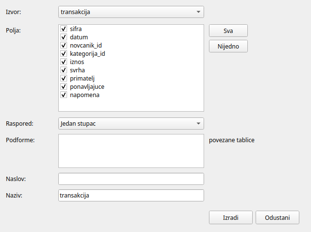
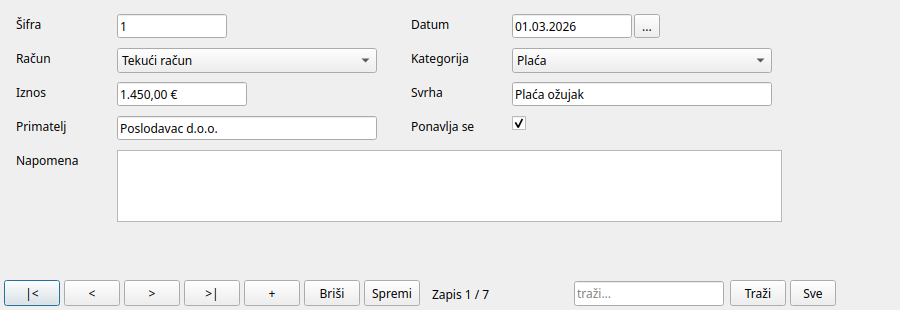

# Forme

Forma prikazuje i uređuje podatke jedne tablice ili upita. Najbrže se pravi **čarobnjakom** (*Forma → Čarobnjak forme…*), a zatim se dotjeruje u **dizajneru** (*Forma → Dizajn*). Za glavni–detalj postoji *Čarobnjak master–detail*.





## Svojstva forme

| Svojstvo | Značenje |
|---|---|
| `Name`, `Caption` | naziv i naslov prozora |
| `RecordSource` | tablica ili spremljeni upit iz kojeg forma čita |
| `Filter` | SQL uvjet koji uvijek vrijedi (npr. `aktivan = 1`) |
| `OrderBy` | poredak redaka |
| `ViewMode` | prazno = jedan zapis; `datasheet` = samo mreža; `split` = zapis iznad, mreža ispod |
| `AllowEdits`, `AllowAdds`, `AllowDeletes` | smije li se mijenjati, dodavati, brisati |
| `NavButtons` | gumbi za kretanje (prvi, prethodni, sljedeći, zadnji, novi, obriši…) |
| `CalcFields` | izračunati stupci u mreži: `Alias=izraz ;; Alias2=izraz2` |
| `GridFormat` | uvjetno bojanje redaka mreže, npr. `[iznos] > 100 => #C00000 #FFE9E9 bold ;; [aktivan] = 0 => #808080` |
| `AutoFill` | kad se promijeni polje-veza, preuzmi vrijednosti iz retka na koji pokazuje: `artikl_id>artikl.sifra:cijena=cijena,naziv_stavke=naziv` |
| `CalcRules` | pravila izračuna koja rade dok se unosi zapis (u mreži, podformi i formi s jednim zapisom): `kolicina,cijena -> iznos = Zaokruzi([kolicina]*[cijena], 2) ;; iznos -> cijena = Zaokruzi([iznos]/[kolicina], 4)`. Lijevo od `->` su polja koja okidaju pravilo, desno cilj i izraz (isti jezik kao u izrazima). Promjena koju pravilo samo upiše ne okida druga pravila, pa dvosmjerni unos nema petlje. Vidi *Kako da…* |
| `Resizable`, `CanMinimize`, `CanMaximize`, `StartMaximized` | prozor forme u radu: smije li mu se mijenjati veličina (inače je fiksna), ima li gumb za smanjivanje i povećanje na cijeli zaslon, otvara li se povećan (zadano: da, da, da, ne) |
| događaji | `OnOpen`, `OnCurrent`, `BeforeUpdate`, `AfterUpdate`, `BeforeDelete`, `OnClose` (vidi *Makroi, događaji i moduli*) |

Pretraga, filtriranje po stupcu i izvoz prikaza u CSV dostupni su u pokrenutoj formi.

### Sidrenje kontrola

Kad korisnik povećava prozor, kontrole se po zadanom ne miču. Svojstvo **`Anchors`** (gumb **…**) kaže uz koje rubove se kontrola drži: **Lijevo** i **Gore** (zadano, ostaje na mjestu), **Desno** (prati desni rub, npr. gumb *U redu*), **Dolje** (prati donji rub) ili **Lijevo + Desno** (rasteže se po širini, npr. tekstualno polje) i **Gore + Dolje** (rasteže se po visini, npr. podforma s retcima). Dijalog ima gotove obrasce: *Fiksno*, *Rasteži vodoravno*, *Rasteži okomito*, *Rasteži oboje*, *Dolje desno*, *Dolje, vodoravno*. Razmak od ruba je onaj iz dizajna. Sidra djeluju u pokrenutoj formi kad se prozor povećava ili povlači rubom, a u dizajneru uživo kad mijenjaš veličinu forme.

### Raspored kao u Lazarusu: Dock, razmaci i sidra uz susjeda

Uz **Anchors** kontrole imaju još tri skupine svojstava za raspored, istog značenja kao u Lazarusu i CodeTyphonu:

* **`Dock`** (Align u Lazarusu): `none` (zadano), `top`, `bottom`, `left`, `right` ili `client`. Kontrola uz rub rasteže se po cijelom rubu forme i prati ga kad se prozor mijenja; `client` ispunjava ostatak. Redoslijed je isti kao u Lazarusu: najprije `top` i `bottom`, zatim `left` i `right`, na kraju `client`; više kontrola uz isti rub slaže se jedna za drugom prema položaju. Kontrola s `Dock` ne koristi Anchors.
* **`BorderSpacing`**: razmak oko kontrole. Jedan broj (`8`) vrijedi za sve četiri strane, a četiri broja (`8,4,8,4`) su lijevo, gore, desno, dolje.
* **`AnchorLeft`, `AnchorTop`, `AnchorRight`, `AnchorBottom`** (AnchorSide u Lazarusu): vežu rub kontrole uz rub ili sredinu **druge kontrole**, zapis je `naziv:strana`. Za lijevi i desni rub strana je `left`, `center` ili `right`, za gornji i donji `top`, `center` ili `bottom`. Primjeri: `AnchorLeft = Natpis:right` stavlja kontrolu desno od kontrole *Natpis* (uz razmak iz `BorderSpacing`), `AnchorTop = Natpis:top` poravnava gornje rubove, `AnchorLeft = forma:center` centrira kontrolu u formi. Naziv `forma` znači roditelja (formu ili karticu). Rub koji je vezan uz susjeda dobiva sidro sam; padajući popis svojstva nudi sve kontrole forme.

Susjed mora biti na istom mjestu kao kontrola (na istoj kartici). Ako se kontrola veže uz sebe ili uz nepostojeću kontrolu, vezi se ne obraća pažnja.

U dizajneru forme raspored djeluje **uživo**: povlačenje hvatišta veličine forme (ili upis `Width` i `Height`) prilagodi sve kontrole sa sidrima i `Dock`om, pomak susjeda povuče kontrole koje su vezane uz njega, a promjena `Dock`a odmah razvuče kontrolu. Položaji se pritom zapišu u definiciju, pa se i kontrola vezana uz rub slobodno povlači dok se ne pusti. Kontrola s `Dock`om koju povučeš mišem nakon puštanja skoči natrag na svoj rub.

### Predložak glavne forme

Čarobnjak izbornika (*Aplikacija → Izbornik*) ima kvačicu **Predložak glavne forme**. Ona izrađuje formu s pet kontrola poredanih samo `Dock`om: zaglavlje (`pnlZaglavlje`, uz gornji rub) s naslovom (`lblNaslov`), bočni izbornik (`mnuBocni`, uz lijevi rub, 240 točaka), statusnu traku (`lblStatus`, uz donji rub) i radno područje (`pnlRadno`, ispunjava ostatak). U opisu aplikacije isto daje `izbornik: glavna`. Predložak je obična forma: u dizajneru se mijenjaju boje, širina izbornika, visina zaglavlja, a kontrole se dodaju ili brišu.

Kad je takva forma **početna forma** aplikacije, ljuska u radu (vidi *Aplikacija u radu*) preuzima njezin izgled: boju zaglavlja iz `pnlZaglavlje` (svojstvo `BackColor`), boju naslova iz `lblNaslov` (`ForeColor`), širinu izbornika iz kontrole `SideMenu` i njegovu stranu: `Dock = right` stavlja izbornik s desne strane. Izbornik se uzima iz iste kontrole `SideMenu`, a sama forma se ne otvara kao kartica.

## Kontrole

| Kontrola | Čemu služi | Glavna svojstva |
|---|---|---|
| `TextBox` | jedan redak teksta, broj ili datum | `ControlSource`, `Format`, `Align` |
| `MemoBox` | dulji tekst | `ControlSource` |
| `RichText` | formatirani tekst (podebljano, kurziv, podcrtano, boja, veličina, poravnanje, natuknice) | `ControlSource` (polje tipa Memo) |
| `Label` | natpis | `Caption`, `Align` |
| `Hyperlink` | poveznica (web, e-pošta, datoteka) | `Caption`, `ControlSource`, `RowSource` (adresa) |
| `Button` | gumb koji izvodi naredbu | `Caption`, `OnClick` |
| `CheckBox` | da/ne | `Caption`, `ControlSource` |
| `ToggleButton` | gumb koji ostaje uključen | `Caption`, `ControlSource`, `OnClick` |
| `ComboBox` | padajući popis | `ControlSource`, `RowSource`, `Search` |
| `ListBox` | popis | `ControlSource`, `RowSource` |
| `OptionGroup` | izbor jednog od više | `Caption`, `ControlSource`, `RowSource` |
| `Subform` | forma unutar forme (detalji) | `RowSource`, `LinkMaster`, `LinkChild`, `CalcFields`, `AutoFill`, `CalcRules` |
| `TabControl` | kartice | `RowSource` (popis kartica) |
| `SideMenu` | bočni izbornik u stilu XP trake zadataka: skupine koje se sklapaju, stavke s ikonama | `Items` (`RowSource`, vidi dolje) |
| `Image` | slika | `ControlSource` (polje s vezom na sliku), `Picture` (stalna slika), `SizeMode` |
| `Chart` | grafikon | `Caption`, `RowSource` (SQL), `ChartType` (`bar`, `line`, `pie`) |
| `Barcode` | barkod | `ControlSource`, `BarType`, `ShowText` |
| `Rectangle`, `Line` | okvir i crta | `BorderWidth` |

Zajednička svojstva: položaj i veličina `Left`, `Top`, `Width`, `Height`; izgled `FontName`, `FontSize`, `Bold`, `Italic`, `ForeColor`, `BackColor`; `CondFormat` (uvjetno oblikovanje teksta); ponašanje `Tip` (savjet), `VisibleIf`, `EnabledIf` (izrazi), `Locked`; `Container` i `Page` (smještaj na karticu); događaji `OnChange`, `OnDblClick`, `OnClick`.

### Formatirani tekst (RichText)

`RichText` je „lakši WordPad” u polju forme: iznad teksta je traka s gumbima **B** (podebljano), **I** (kurziv), **U** (podcrtano), **A** (boja teksta), padajući popis veličine u točkama, **◀ ≡ ▶** (lijevo, središnje, desno), **•** (natuknica) i **✕** (očisti oblikovanje). Oblikuje se označeni dio teksta; ponovni klik na isti gumb skida oblikovanje.

Tekst se u bazu sprema kao **običan tekst u polju tipa Memo**, u malom HTML-u: `<p align="center">` je odlomak, uz `<b>`, `<i>`, `<u>` i `<font color="#rrggbb" size="14">`, a natuknica je `<p list="1">`. Zato radi jednako na SQLite-u, PostgreSQL-u i MariaDB-u i može se izvesti, a funkcija `PlainText([polje])` daje čitljiv tekst za popise i pretraživanje. Stari običan tekst u istom polju čita se kao odlomci (razdvojeni novim retkom) i postaje formatiran čim ga spremiš.

U izvješćima stavka `RichText` ispisuje isti tekst s pravim fontovima, bojama i poravnanjem. **Redak se sam produlji** da stane cijeli tekst, a stavke ispod pomaknu se prema dolje, pa tekst može biti dug. Tekst se lomi po širini stavke; ispis radi u pregledu, PDF-u, HTML-u i na pisaču. Primjer je u bazi *Trgovina Jadran* (*Obavijesti*).

Ograničenja prve verzije: nema tablica ni slika unutar teksta, font je zadani (mijenjaju se veličina i boja), a natuknice su jedna razina bez brojeva.

### Izvor kontrole

`ControlSource` je ili ime polja (`kupac_id`), ili izraz s predznakom `=` (izračunata kontrola, samo za čitanje): `=[kolicina] * [cijena]`.

### Padajući popis iz druge tablice

`RowSource` za `ComboBox` je SQL koji daje dva stupca (vrijednost i prikaz) ili ime tablice; čarobnjak ga sam postavlja za polja s vezom (stranim ključem), pa korisnik vidi naziv, a u polje ide šifra. `Search` uključuje traženje upisom.

### Slike

Kontrola `Image` vezana uz polje tipa *Picture* prikazuje sliku na koju pokazuje veza. Dvoklik (ili desni klik → *Odaberi sliku…*) kopira odabranu datoteku u mapu pohrane i upisuje vezu u polje; *Ukloni sliku* briše vezu (datoteka ostaje). Stalna slika (npr. logo) postavlja se svojstvom `Picture`; i ona se čuva kao datoteka u pohrani, ne u definiciji forme. Pojedinosti u poglavlju *Slike i datoteke*.

### Barkodovi

`BarType`: `code128`, `ean13`, `ean8`, `code39`, `itf`, `qr`, `pdf417`; vrijednost `hub3` isto je što i `pdf417` i koristi se uz funkciju `Hub3Uplata(...)` za 2D barkod HUB-3 uplatnice.

## Podforme i master–detalj

*Čarobnjak master–detail* pravi formu glavnog zapisa s podformom stavki koje pripadaju tom zapisu; veza se uzima iz stranog ključa (*Baza → Relacije*). Ručno: kontrola `Subform` s `RowSource` = forma detalja, `LinkMaster` = polje glavne forme, `LinkChild` = polje podforme. Zbrojevi stavki mogu se prikazati u glavnoj formi (`=DSum("iznos", "stavka", "racun_id = " & [id])`).

## Provjera unosa

Provjera se postavlja na polje tablice (svojstva polja): izraz u kojem je `[value]` unos, npr. `Len([value]) = 11`; uz njega ide poruka koja se pokazuje korisniku. Zadana vrijednost polja je izraz koji se računa za svaki novi zapis (`Date()`).

### Bočni izbornik (SideMenu)

Kontrola `SideMenu` je nacrtana u programu (bez vanjskih komponenti) i prati svijetlu i tamnu temu. Stavke se uređuju svojstvom **Items** (tipka s tri točke otvara uređivač), jedan redak po stavci:

```
# Prodaja|invoice
Računi|openform:Računi
Ponude|openform:Ponude|offer
# Alati
Postavke|macro:Postavke
```

* `# Naslov|ikona` je skupina: klik je sklapa i otvara; ikona nije obavezna.
* `Natpis|akcija|ikona` je stavka. Akcija je ista kao na gumbu (`openform:`, `openreport:`, `openletter:`, `macro:`, `openquery:`…). Ako ikone nema, program je bira sam prema akciji i natpisu (iz zalihe ikona).
* **Harmonika**: svojstvo `Accordion` (zadano uključeno) drži otvorenu samo jednu skupinu; kad otvoriš drugu, prethodna se sklopi. Na početku je otvorena prva skupina. Isključeno, skupine se otvaraju i zatvaraju neovisno.
* **Praćenje**: zadnja kliknuta stavka ostaje označena (podebljana, s trakom uz rub), a program po korisniku pamti koja je skupina bila otvorena i koja stavka zadnja korištena (datoteka `sidemenu.ini` u korisničkoj konfiguraciji). Pri sljedećem otvaranju forme izbornik se vraća u to stanje.
* Kotačić miša pomiče izbornik kad stavki ima više nego što stane. Sidrenje (*Anchors*) rastegne izbornik uz rub forme, pa radi kao stalni bočni izbornik cijele forme.

Čarobnjak izbornika (*Aplikacija → Izbornik*) nudi izbornik kao **bočni izbornik** umjesto gumba (kvačica pri dnu); gumb *Skupina...* dodaje naslov skupine, a sljedeće stavke ulaze u nju.

## Aplikacija u radu: prijava, radni prostor i kartice

Kad se aplikacija pokrene u radu (`--runtime`, ili korisnik koji nije administrator), tok je uvijek isti:

1. **Prijava.** Ako baza ima korisnike, prvo se otvara prozor za prijavu. Baza bez ijednog korisnika ulazi bez prijave kao administrator (inače se nitko ne bi mogao prijaviti).
2. **Glavni prozor s bočnim izbornikom.** Zaglavlje (naslov aplikacije, prijavljeni korisnik, *Odjava*), bočni izbornik s lijeve strane i radni prostor s kućicama (karticama) desno. Izbornik se slaže iz **početne forme** aplikacije: ako sadrži kontrolu `SideMenu`, koristi se njezin popis; ako je običan izbornik s gumbima (čarobnjak izbornika), gumbi i naslovi skupina postaju stavke izbornika; ako početna forma nije izbornik, izbornik se slaže sam iz forma, izvješća i makroa koje korisnik smije otvoriti, a sama početna forma otvara se kao prva kartica. Izbornik je harmonika (otvorena je jedna skupina) i pamti zadnju stavku.
3. **Svaka forma je kartica.** Otvaranje forme iz izbornika (ili gumbom `openform:`) otvara novu karticu s ikonom forme; zatvaranjem kartice (×, srednji klik na karticu, ili `Close` gumb na formi) zatvara se forma i provjerava se ima li nespremljenih promjena. Izvješća, dopisi i makroi i dalje se otvaraju svaki u svojem prozoru.

**Pravila otvaranja**

* Ista forma može biti otvorena samo **jednom**: ponovno otvaranje samo prebacuje na njezinu karticu.
* Forme iste **skupine isključivosti** ne mogu biti otvorene zajedno. Skupina se upisuje u svojstvo forme **ExclusiveGroup** (dizajner forme, svojstva forme). Primjer: sve skladišne dokumente (primka, otpremnica, revers) stavi u skupinu *Skladišni dokumenti*: dok je otvorena otpremnica, revers se ne može otvoriti nego dojavi poruku i prebaci na otpremnicu. Isto za *Financijske dokumente*. Čarobnjaci i primjeri sami upisuju skupine za račune, ponude, ugovore, putne naloge i blagajnu (financijski dokumenti) te otpremnice, narudžbenice i skladišne dokumente.
* Odjava zatvara sve kartice (uz isto pitanje o nespremljenim promjenama) i ponovno otvara prijavu, pa novi korisnik dobiva izbornik prema svojim pravima.

## Objedinjeni dokumenti: jedna forma za više vrsta

Umjesto posebne forme i tablice za svaku vrstu dokumenta (otpremnica, revers, račun…), jedna forma **Dokument** radi za sve vrste, a izbornik je otvara s parametrom:

```
Otpremnice|openform:Dokument#vrsta=otp
Reversi|openform:Dokument#vrsta=rv
```

**Tablica `dokumenti`** (po jedan redak za svaku vrstu; uređuje se u *Aplikacija → Vrste dokumenata…*):

| Stupac | Značenje |
|---|---|
| `vrsta` | oznaka vrste (`otp`, `rv`, `rac`), parametar iz izbornika |
| `naziv` | naziv za prikaz; postaje naslov kartice (*Otpremnica*) |
| `sifradok` | prefiks broja (`otp`) |
| `rednidok` | zadnji dodijeljeni redni broj |
| `godina` | godina zadnjeg broja: svake godine brojanje počinje iznova |
| `format` | oblik broja: `{sifra}` prefiks, `{godina}` ili `{godina:2}`, `{broj:4}` redni broj s 4 znamenke; zadano `{sifra}-{godina}-{broj:4}` daje `otp-2026-0001`; revers koristi istu formu, samo mu je prefiks `rv` |
| `srodne` | vrste koje ne smiju biti otvorene dok je ova otvorena (oznake odvojene zarezom); vrijedi u oba smjera |

**Kako forma radi**

* Forma ima svojstva **DocTypeField** (polje s vrstom, npr. `vrsta`) i **DocNumberField** (polje s brojem, npr. `broj`). Kad se otvori s `#vrsta=otp`, prikazuje samo dokumente te vrste, svaki novi dokument dobiva tu vrstu, a naslov kartice je naziv vrste.
* Novi dokument odmah **predlaže broj** iz zadnje upisane vrijednosti (`rednidok + 1`), ali ga ne troši. Tek pri **spremanju** broj se stvarno dodjeljuje i novi zadnji broj upisuje u tablicu `dokumenti`, pa neispunjen novi dokument ne ostavlja rupu u brojevima.
* Svaka vrsta ima svoju karticu (otpremnica i račun mogu biti otvoreni zajedno, u istoj formi), a ista vrsta otvara se samo jednom.
* Otvaranje vrste čija je **srodna** vrsta već otvorena (npr. revers dok je otvorena otpremnica) odbija se s upozorenjem koja je vrsta otvorena, i prebacuje na njezinu karticu. Srodne se biraju u prozoru *Vrste dokumenata*, neovisno o izborniku i o formama.
* Predložak **Objedinjeni dokumenti** (čarobnjak za poslovne aplikacije) izrađuje tablice `dokument` i `dokument_stavke`, formu *Dokument*, ispis i vrste `rac`, `pon`, `pred`, `nar`, `otp` i `rv` (otpremnica i revers su međusobno srodni). Čarobnjak izbornika za takvu formu sam dodaje jednu stavku po vrsti.

**Više mjesta za forme:** gumb s tri crte lijevo u zaglavlju **pričvršćuje** izbornik (širok, stalno otvoren) ili ga **sklapa u usku traku s ikonama**. Sklopljen izbornik pokazuje samo **skupine** (po jedna ikona; ako skupina nema svoju ikonu, uzima se ikona njezine prve stavke) i daje formi cijelu širinu prozora; naziv skupine vidi se u oblačiću, a kad miš dođe na traku, izbornik se privremeno otvori **iznad** forme, s otvorenom skupinom na čiju je ikonu miš došao, i sklopi se čim miš ode. Izbor se pamti po korisniku i bazi.

