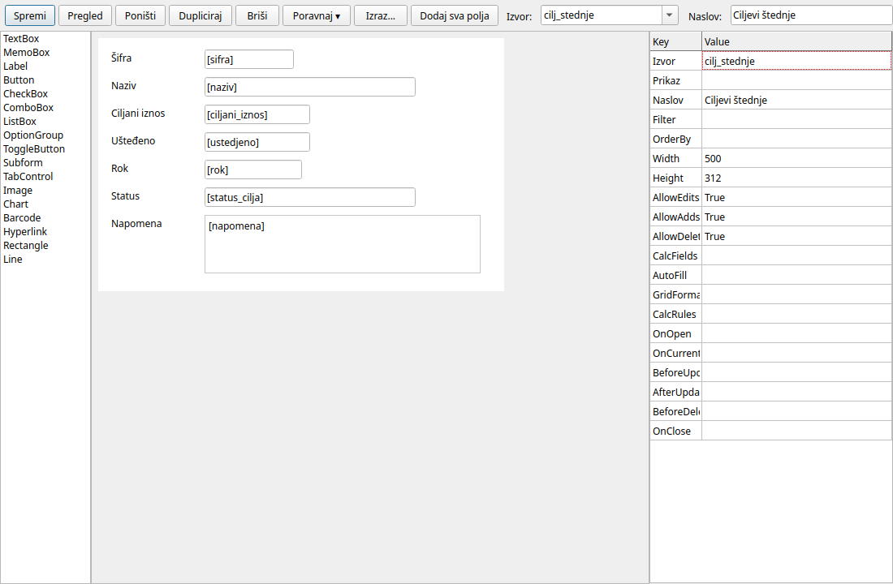
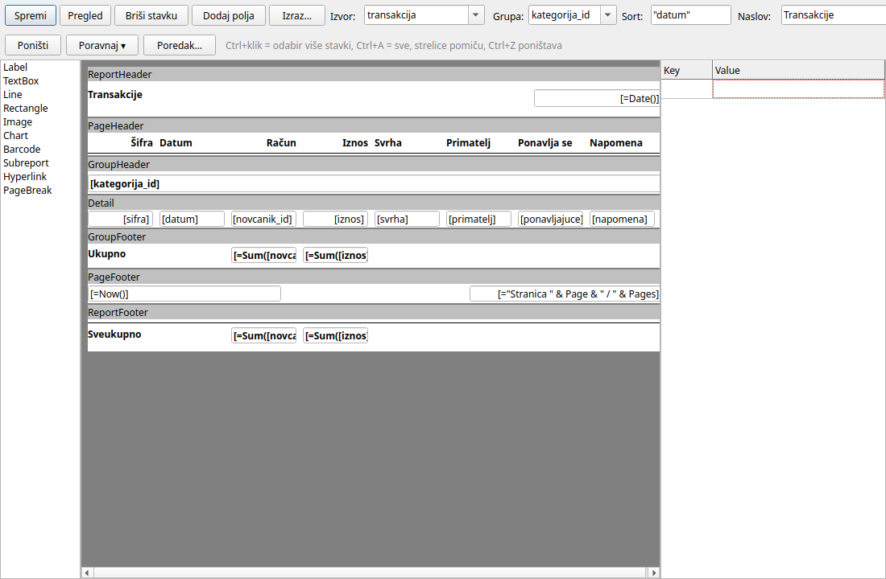

# Dizajner forme i dizajner izvješća

Dizajneri se otvaraju iz izbornika (*Forma → Dizajn*, *Izvješće → Dizajn*) ili tipkom **Dizajn** iz čarobnjaka. Obje radne površine su slične: lijevo popis vrsta kontrola, u sredini površina na kojoj se slaže, desno popis svojstava odabrane kontrole.

## Dizajner forme

### Dodavanje i uređivanje

1. **Izvor:** na vrhu odaberi tablicu ili upit iz kojeg forma čita. **Naslov:** naslov prozora.
2. **Dodaj sva polja** postavlja jednu kontrolu za svako polje izvora; kontrole se biraju prema logičkom tipu (tekst, da/ne, padajući popis za polje s vezom).
3. Pojedinačnu kontrolu dodaješ tako da u lijevom popisu odabereš vrstu (npr. `TextBox`), pa **klikneš na površinu** na mjesto gdje ide. Klik na praznu površinu bez odabrane vrste poništava odabir.
4. Klikom označiš kontrolu i povlačiš je. Oko označene kontrole je **osam hvatišta** (uglovi i sredine stranica), kao u Lazarusu: povlačenjem hvatišta pomičeš samo te rubove, a suprotni rub ostaje na mjestu (lijevo i gore mijenjaju i položaj). Veličinu možeš mijenjati i povlačenjem **samog ruba** kontrole. Pomicanje i veličina idu po mreži od 4 točke; kontrola ne može postati manja od 8 × 8 točaka (crte i pravokutnici mogu biti tanji).
5. Svojstva odabrane kontrole mijenjaš u desnom popisu. Kad nije odabrana nijedna kontrola, popis pokazuje svojstva **same forme**: `Izvor`, `Prikaz` (prazno, `datasheet`, `split`), `Naslov`, `Filter`, `OrderBy`, `Width`, `Height`, `AllowEdits`, `AllowAdds`, `AllowDeletes`, `CalcFields`, `AutoFill`, `GridFormat` i događaje `OnOpen`, `OnCurrent`, `BeforeUpdate`, `AfterUpdate`, `BeforeDelete`, `OnClose`.
6. Svojstva boje, slike, izraza i višeredni tekstovi imaju vlastite dijaloge. **Izraz…** otvara uređivač izraza s popisom polja, grupama funkcija (dvoklik umeće primjer) i gumbom **Provjeri**.
7. **Spremi** sprema formu u bazu. **Pregled** prvo spremi formu pa je pokrene s pravim podacima; kad je zatvoriš, vraćaš se u dizajner.

### Veličina forme

Veličina forme (površine na kojoj se slaže) mijenja se na tri načina: upisom u polja **Veličina forme (px)** u drugoj traci, svojstvima `Width` i `Height` (kad nije označena nijedna kontrola) i **povlačenjem plavih hvatišta** uz desni rub, donji rub i donji desni kut površine. Povlačenje ide po mreži od 4 točke, forma ne može biti manja od 120 × 80 i cijela promjena se poništava jednim korakom (*Poništi*).

### Sidrenje i prozor

Svojstvo kontrole **Anchors** (gumb **…** u popisu svojstava) otvara **uređivač sidrenja i rasporeda**, kao Lazarusov Anchor Editor: u jednom prozoru se postavljaju **Dock**, sidra **Lijevo, Gore, Desno, Dolje** (uz rub forme ili uz susjednu kontrolu, s odabirom njezine strane), razmak od rubova (po stranama ili isti sa svih strana) i gotovi obrasci. Pregled lijevo crta formu, susjede i kontrolu u mjerilu, a narančaste strelice pokazuju kamo je koja strana vezana. Isti prozor otvaraju i **BorderSpacing** i sva četiri sidra (**AnchorLeft** … **AnchorBottom**), pa više nije potrebno tipkati `Naziv:strana`; zapis u definiciji je isti kao i prije. Uz njega **Dock**, **BorderSpacing** i sidra uz susjeda (**AnchorLeft**, **AnchorTop**, **AnchorRight**, **AnchorBottom**) rade kao u Lazarusu (opis je u poglavlju *Forme*), i to uživo: kad povlačiš hvatište veličine forme, kontrole se prilagođavaju. Svojstva forme **Resizable**, **CanMinimize**, **CanMaximize** i **StartMaximized** (kad nije označena nijedna kontrola) određuju može li se prozor povećavati, ima li gumbe za smanjivanje i povećanje i otvara li se na cijelom zaslonu.

### Ikone i izgled

Alatne trake, paleta kontrola, izbornici, popis objekata (traka s ikonama lijevo) i gumbi za kretanje po zapisima imaju ikone iz zajedničkog skupa (197 ikona, isti crtež u veličinama 16, 24 i 32 točke, svijetla i tamna izvedba; generira se alatom `tools/gen_icons.py`, a gotove slike (PNG i SVG) leže u mapi `ikone/`). Izgled programa ima tri izbora u izborniku *Aplikacija*: **moderno svijetlo** (zadano: ravni gumbi, zaobljena polja, tanke klizne trake), **moderno tamno** (tamna podloga, tablice i popisi prebojani, ikone svijetle izvedbe; boje koje si sam odabrao u formi ostaju) i **sustavni** (bez stilske tablice). Izbor se pamti po korisniku, ne po bazi.

### Tipke i naredbe

| Radnja | Kako |
|---|---|
| više kontrola odjednom | **povuci okvir** po praznoj površini (označi sve što okvir dotakne), **Ctrl+povlačenje okvira** dodaje u odabir, **Ctrl+klik** dodaje ili uklanja pojedinu kontrolu, **Ctrl+A** za sve |
| pomak skupine | povuci bilo koju od označenih kontrola: sve idu zajedno |
| pomak za jedan korak mreže | strelice; sa **Ctrl** pomak od jedne točke |
| promjena veličine tipkovnicom | **Shift+strelice** za korak mreže, **Ctrl+Shift+strelice** za jednu točku |
| točna veličina i položaj | upiši `Left`, `Top`, `Width`, `Height` u desni popis i pritisni **Enter** |
| brisanje | **Delete** ili gumb **Briši** |
| dupliciranje | **Ctrl+D** ili **Dupliciraj** |
| poništavanje | **Ctrl+Z** ili **Poništi** (do 60 koraka) |
| poravnanje | gumb **Poravnaj ▾**: poravnaj lijevo, desno, gore, dolje; centriraj vodoravno ili uspravno; ista širina, visina ili veličina; jednak razmak vodoravno ili uspravno |
| redoslijed slojeva | **Poravnaj ▾ → Na vrh / Na dno** (kasnije dodano je iznad) |

Poravnanja rade nad označenim kontrolama (treba ih biti barem dvije).

**Veličina forme:** druga traka dizajnera forme ima polja **Veličina forme (px)**: širina × visina površine, upisuje se izravno (isto kao `Width` i `Height` kad nije označena nijedna kontrola). Promjena se može poništiti.

### Savjeti

* Kontrole `TabControl` imaju kartice; kontrolu dodaješ na karticu klikom na samu karticu. Svojstva `Container` i `Page` pamte gdje kontrola stoji.
* Izračunata kontrola: u `ControlSource` upiši `=izraz`. Ona se računa pri prikazu svakog retka.
* Za zaključavanje cijele forme isključi `AllowEdits`, `AllowAdds`, `AllowDeletes`.
* Gumbi: svojstvo `OnClick` je naredba iz poglavlja *Makroi* (`openform:Računi`, `macro:Provjera`, `save`, `new`…).
* Jedan izvor, više prikaza: ista tablica može imati više formi (unos, pregled, mreža).

## Dizajner izvješća

Radi na isti način, uz razlike:

* Na površini je **sedam odjeljaka** (zaglavlje izvješća, zaglavlje stranice, zaglavlje grupe, detalj, podnožje grupe, podnožje stranice, podnožje izvješća). Klik na traku odjeljka pokazuje njegova svojstva, među kojima je `Height` (visina); stavka pripada odjeljku u koji je smještena.
* Vrste stavki: `Label`, `TextBox`, `Line`, `Rectangle`, `Image`, `Chart`, `Barcode`, `Subreport`, `Hyperlink`, `PageBreak`.
* Alatna traka: **Spremi**, **Pregled**, **Briši stavku**, **Dodaj polja** (stavke za polja izvora), **Izraz…**.
* Druga traka: **Poništi**, **Poravnaj ▾** i **Poredak…** (dijalog za svojstvo `SortBy`: do četiri polja, uzlazno ili silazno).
* Svojstva izvješća: izvor (tablica ili upit), `GroupField` (grupiranje), `SortBy`, `Filter`, `Columns` i `ColumnGap` (stupci za naljepnice), te visine odjeljaka te `SortOptions` (ponuđeni poredci za odabir u pregledu, gumb **…**).
* **Stranica i naljepnice…** otvara postavke stranice, vidi niže.
* Odabir više stavki i pomicanje skupine radi isto kao u formi (okvir po praznom dijelu odjeljka, može i preko više odjeljaka).
* Tipke: strelice (pomak, sa **Ctrl** za jednu točku), **Shift+strelice** (veličina), **Delete**, **Ctrl+Z**, **Ctrl+A**. Veličina se mijenja povlačenjem ruba kontrole (hvatišta su nacrtana uz rub unutar kontrole).
* **Pregled** prikazuje stvarne stranice i nudi PDF, HTML i ispis.

### Stranica, margine i naljepnice

Gumb **Stranica i naljepnice…** (druga traka dizajnera izvješća) postavlja, u milimetrima:

* **Papir:** A4, A5, A6, A3, Letter, Legal ili vlastita širina × visina; kvačica **Položeno** okreće papir. Zadano je A4 uspravno.
* **Margine:** lijevo, gore, desno, dolje. Zadano je oko 10,6 mm (40 točaka).
* **Naljepnice / stupci:** popis gotovih araka (npr. 63,5 × 38,1 mm, 3 × 7; 99,1 × 38,1 mm, 2 × 7; 70 × 37 mm, 3 × 8 bez margina; 105 × 74 mm, 2 × 4) ili **Prilagođeno**: broj naljepnica u retku, širina i visina jedne naljepnice, **razmak** među stupcima i među redovima. Dijalog javlja koliko naljepnica stane na stranicu.

Za naljepnice visina naljepnice postaje visina odjeljka `Detail`, desna margina se računa iz ostatka lista, a prazni odjeljci zaglavlja i podnožja skupljaju se na nulu da ne oduzimaju mjesto. U `Detail` ide sadržaj **jedne** naljepnice; crvena točkasta crta pokazuje gdje naljepnica završava. Stupaca 1 znači običan izvještaj. Mjere gotovih araka provjeri prema pakiranju koje kupuješ. Postavke vrijede i za pregled, PDF, HTML i ispis. Starija izvješća bez ovih postavki ostaju A4 s dosadašnjim marginama.

### Tipični obrasci

* **Popis s grupama:** `GroupField` = `kategorija`; u `GroupHeader` naziv grupe, u `Detail` polja retka, u `GroupFooter` zbroj `=Sum([iznos])`, u `ReportFooter` ukupni zbroj.
* **Račun (kartica):** vrsta *Stupčasto* ili *master–detail*; zaglavlje tvrtke u `ReportHeader`, stavke u podizvješću, ukupno slovima `=IznosSlovima([ukupno])`, barkod uplatnice `=Hub3Uplata(...)` s `BarType` `pdf417`.
* **Naljepnice:** vrsta *Naljepnice*; `Columns` = 3, razmak `ColumnGap`.
* **Brojanje stranica:** u `PageFooter` stavka `=Page & " / " & Pages`.

### Ikone u aplikacijama

Zaliha ikona (mapa `ikone/`, pregled u `ikone/pregled-svijetle.png` i `pregled-tamne.png`) pokriva i sve što primjeri aplikacija izrađuju: tablice (kupci, dobavljači, računi, ponude, ugovori, skladište, putni nalozi…), vrste polja (tekst, broj, datum, iznos, postotak, e-pošta, telefon, OIB…) i radnje gumba.

- **Gumbi**: svojstvo **Icon** (gumb i preklopni gumb) otvara izbornik ikona s pretragom; dvoklik bira, *Bez ikone* briše. Gumbi koje izrađuju čarobnjaci, izbornici i primjeri dobivaju ikonu sami prema radnji i natpisu (*Otvori Kupci* → ikona kupca, *Spremi* → disketa).
- **Popisi objekata** u glavnom prozoru (tablice, forme, upiti, izvješća, dopisi, moduli, makroi, 4GL) prikazuju ikonu prema nazivu objekta.
- **Kartica Design** prikazuje uz svako polje ikonu prema nazivu i vrsti polja.
- **Vlastite ikone**: PNG u `~/.config/TyphAccess/ikone/NAZIV.png` (tamna izvedba `NAZIV-tamna.png`) ima prednost pred ugrađenom ikonom istog naziva.
- **Slike u izvješćima i formama** (npr. zaglavlje računa): svojstvo **Picture** kontrole Image nudi *Iz zalihe ikona (velika)* ili *Iz datoteke*. Ikone iz zalihe i **SVG** datoteke ostaju **vektori**: u definiciji se pamti samo mali SVG tekst (oko 3 KB, a ne PNG od više desetaka KB), pa i izvješće i baza ostaju male. Vektor se crta tek pri prikazu, točno u veličini kutije: na zaslonu, pisaču, u HTML izvozu kao pravi SVG, a u PDF-u kao **pravi vektor** (putanje, oblici, grupe, transformacije, `use`; PDF ostaje malen i oštar pri svakom povećanju). SVG s gradijentima, tekstom, isjecanjem, filtrima ili crtkanim linijama u PDF-u ide kao slika od 300 točaka po inču. PNG, JPG, BMP i GIF rade kao i prije. U mapi `ikone/` su sve ikone i kao SVG te PNG 64, 128 i 256.
