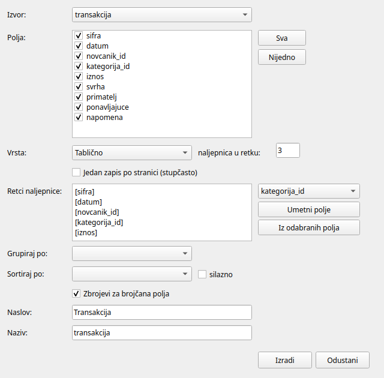
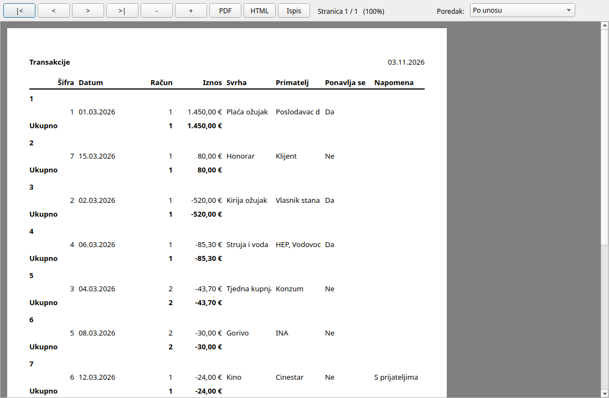

# Izvješća

Izvješće je ispis podataka s grupama, zbrojevima i oblikovanjem. Izrađuje se čarobnjakom (*Izvješće → Čarobnjak izvješća…*), a dotjeruje u dizajneru (*Izvješće → Dizajn*). Pregled (*Izvješće → Pregled*) prikazuje stranice A4; iz pregleda se izvozi **PDF**, **HTML** ili šalje na **pisač**.





## Vrste iz čarobnjaka

| Vrsta | Za što |
|---|---|
| *Tablično* | popis redaka u stupcima, s grupama i zbrojevima |
| *Stupčasto (kartica)* | jedan zapis po stranici: obrazac, potvrda, račun |
| *Naljepnice* | više kartica jedna pored druge (npr. 3 stupca naljepnica adresa); redci naljepnice zadaju se u čarobnjaku |
| *Sažetak (samo zbrojevi)* | samo zbrojevi po grupama, bez pojedinačnih redaka |

*Čarobnjak master–detail izvješća* pravi izvješće glavnog zapisa s detaljima (npr. račun sa stavkama), s prijelomom stranice po glavnom zapisu.

## Odjeljci

Izvješće ima sedam odjeljaka (pojasa), kao u Accessu:

| Odjeljak | Ispisuje se |
|---|---|
| `ReportHeader` | jednom, na početku izvješća |
| `PageHeader` | na vrhu svake stranice |
| `GroupHeader` | na početku svake grupe |
| `Detail` | za svaki redak |
| `GroupFooter` | na kraju svake grupe (zbrojevi grupe) |
| `PageFooter` | na dnu svake stranice |
| `ReportFooter` | jednom, na kraju (ukupni zbrojevi) |

Visina svakog odjeljka postavlja se u dizajneru. `Columns` i `ColumnGap` raspoređuju redove detalja u više stupaca (naljepnice). `GroupField` je polje po kojem se grupira, `SortBy` poredak, `Filter` SQL uvjet.

## Stavke

Stavke su iste vrste kao kontrole forme: `Label`, `TextBox`, `RichText` (formatirani tekst iz polja, redak se sam produlji), `Hyperlink`, `Image`, `Chart`, `Barcode`, `Subreport`, `Rectangle`, `Line`, `PageBreak`. Uz njih postoje svojstva izgleda (font, boje, poravnanje), `Format` i `CondFormat` (uvjetno oblikovanje).

### Izrazi i zbrojevi

Izvor stavke je polje ili izraz s `=`:

Zbrojevi se računaju nad opsegom odjeljka u kojem stoje: u `GroupHeader`/`GroupFooter` nad redcima grupe, u `ReportHeader`/`ReportFooter` nad svim redcima, u `Detail` nad grupom. Prazne (Null) vrijednosti se preskaču.

| Izraz | Značenje |
|---|---|
| `=Sum([iznos])` | zbroj |
| `=Count([id])`, `=Count(*)` | broj redaka s vrijednošću, odnosno svih redaka |
| `=Avg([iznos])`, `=Min([iznos])`, `=Max([iznos])` | prosjek, najmanje, najveće |
| `=First([x])`, `=Last([x])` | prva i zadnja vrijednost |
| `=StDev([x])`, `=Var([x])`, `=Median([x])` | standardna devijacija, varijanca, medijan |
| `=SumAll([x])`, `=CountAll([x])`, `=AvgAll([x])` | isto, ali uvijek nad **svim** redcima izvješća (npr. udio grupe u cjelini) |
| `=RunSum([x])`, `=RunCount([x])` | tekući zbroj/broj od prvog retka do trenutnog |
| `=RunGSum([x])` | tekući zbroj unutar grupe |
| `=RunGCount(*)` | redni broj retka unutar grupe (1, 2, 3… pa ponovo od 1 u svakoj grupi); `=RunCount(*)` je redni broj kroz cijelo izvješće |

Argument zbroja može biti i **izraz**: `=Sum(Iif([placeno] = 1, [iznos], 0))` zbraja samo plaćene (vrijedi za `Sum`, `Count`, `Avg`, `First`, `Last` i druge; `Min` i `Max` s jednim argumentom ostaju obične funkcije).

```
=Format(Sum([iznos]), "Currency")
=Page & " / " & Pages                  broj stranice
=Iif(Sum([iznos]) > 1000, "VELIKO", "")
=Percent(Sum([iznos]), SumAll([iznos]))    udio grupe u ukupnom iznosu
=IznosSlovima([ukupno])                iznos riječima
```

Svi izrazi iz *Reference izraza* rade i u izvješćima.

### Varijable izvješća

Uz zbrojeve, u izrazima izvješća postoje varijable (pišu se bez uglatih zagrada):

| Varijabla | Vrijednost |
|---|---|
| `Page`, `Pages` | broj stranice i ukupan broj stranica izvješća |
| `GroupPage`, `GroupPages` | broj stranice **unutar grupe** i broj stranica koje ta grupa zauzima (počinje od 1 u svakoj grupi) |
| `RowNum`, `RowCount` | redni broj retka u cijelom izvješću i ukupan broj redaka |
| `GroupRow`, `GroupRows` | redni broj retka unutar grupe i broj redaka grupe |
| `Date`, `Now` | današnji datum, trenutno vrijeme |

Primjer: `="Stranica " & GroupPage & " / " & GroupPages` u `PageFooter` (uz prijelom stranice na vrhu zaglavlja grupe).

### Uvjetno oblikovanje

`CondFormat` ima pravila oblika `izraz => boja_teksta boja_pozadine [bold]`, odvojena sa `;;`:

```
[iznos] > 1000 => #C00000 #FFE9E9 bold ;; [iznos] < 0 => #808080
```

### Grafikon

`Chart` crta iz SQL-a (`RowSource`): dva stupca — oznaka i vrijednost. `ChartType`: `bar` (stupci), `line`, `pie`.

### Barkodovi i uplatnice

`Barcode` crta `code128`, `ean13`, `ean8`, `code39`, `itf`, `qr`, `pdf417` (`BarType`). Za 2D barkod HUB-3 uplatnice izvor je izraz s funkcijom `Hub3Uplata(iznos, platitelj, adresa, mjesto, primatelj, adresa, mjesto, iban [, model, poziv, šifra namjene, opis])`, a `BarType` je `pdf417`. Podaci o primatelju (tvrtki) postavljaju se u *Aplikacija → Podaci o tvrtki* i čitaju funkcijom `Postavka("firma.naziv")`.

### Podizvješće

`Subreport` ugrađuje drugo izvješće u odjeljak; `LinkMaster`/`LinkChild` vežu ga uz polje glavnog izvješća (npr. stavke računa uz račun).

### Prijelom stranice

`PageBreak` u odjeljku `GroupHeader` ili `Detail` počinje novu stranicu. Na **vrhu** odjeljka (`Top` = 0) prelama **prije** njega (prva grupa ne daje praznu stranicu), a s `Top` većim od 0 **nakon** njega (u `GroupFooter` ostaje prazna stranica iza zadnje grupe).

## Parametri

Upit ili uvjet s oznakom `[?Naziv]` traži vrijednost pri pokretanju (dijalog „Unesi parametre upita”). Datum se može upisati kao `31.12.2026` ili `2026-12-31`; prazno polje znači NULL.

## Izvoz i ispis

* **PDF** — font DejaVu Sans (uključuje hrvatska slova); jedan dokument sa svim stranicama.
* **HTML** — stranica koja izgleda kao izvješće.
* **Ispis** — na zadani pisač.
* Iz planera zadataka (*Aplikacija → Planer zadataka*) izvješće se može automatski pretvarati u PDF po rasporedu (`--run-tasks`).

## Posebna izvješća

* **Unakrsni upit** (*Upit → Unakrsni upit i unija*) — retci × stupci s zbrojem; dodaje se stupac *Ukupno*; rezultat se sprema kao upit pa može biti izvor izvješća.
* **Unija** — spaja rezultate više upita (`UNION`, ili `UNION ALL` ako treba zadržati duplikate).
* **Dokumentacija baze (HTML)** — *Baza → Dokumentacija baze*: sve tablice, polja, veze.
* **Računi, uplatnice, blagajna, skladište** — gotovi predlošci su u *Aplikacija → Poslovni predlošci…*.
* **Tekstualna izvješća u 4GL-u** — `REPORT` blokovi s grupama, stranicama, zbrojevima i `PERCENT`, ispis na zaslon, datoteku, PDF, pisač ili cijev (poglavlje 4GL).
