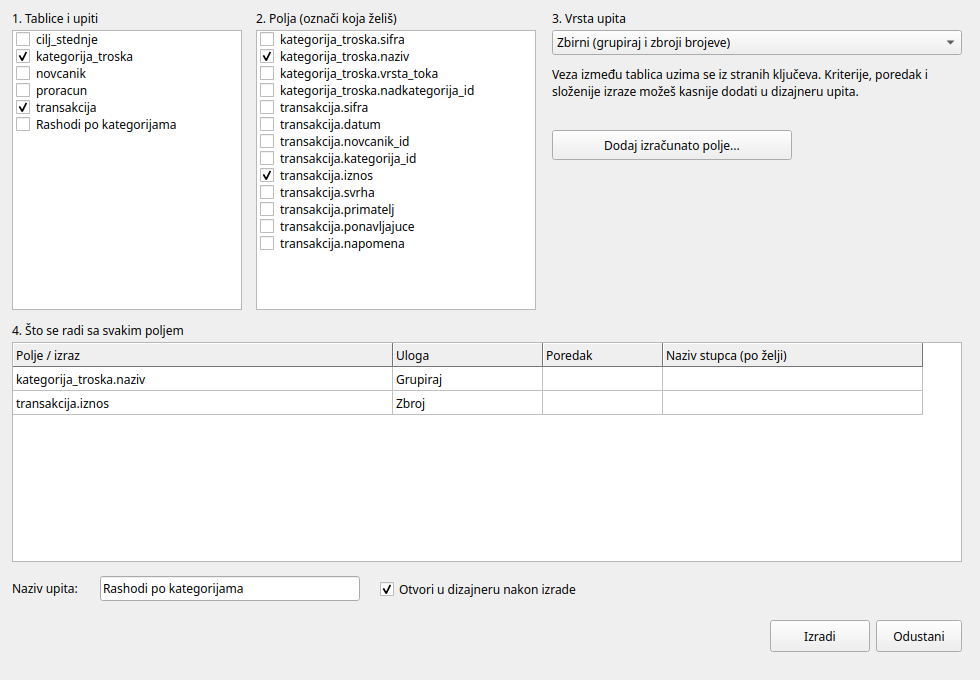
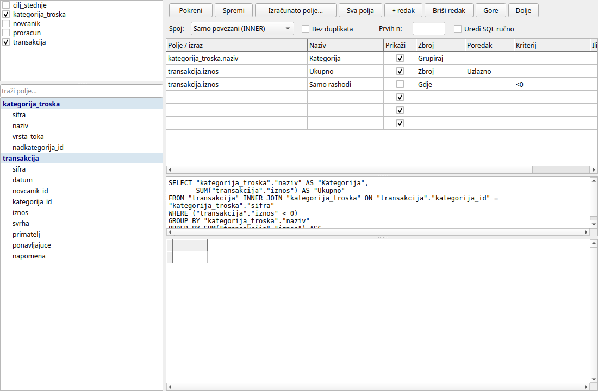
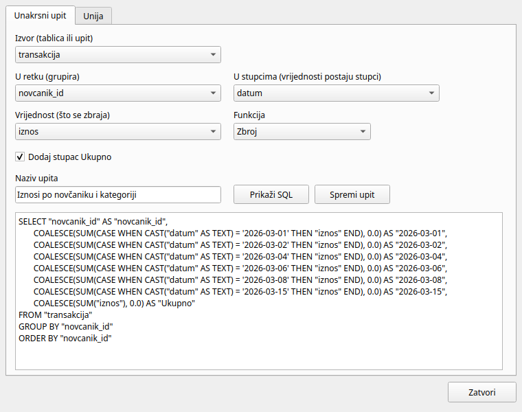
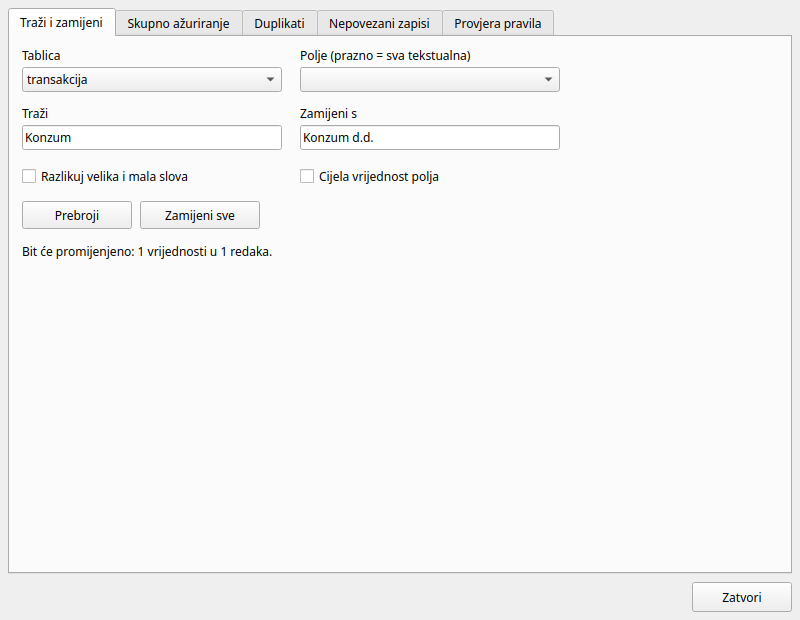

# Upiti

Upit je spremljeni SQL. Rezultat se otvara kao mreža, a upit se može koristiti kao izvor forme, izvješća i drugog upita. Upiti se izrađuju na tri načina: **čarobnjakom**, **dizajnerom** (rešetka po uzoru na Access) i **ručno** (SQL).

## Čarobnjak upita



*Upit → Čarobnjak upita…* vodi kroz četiri koraka:

1. **Tablice i upiti** — što se povezuje. Veza se uzima iz stranih ključeva (*Baza → Relacije*).
2. **Polja** — označi koja polja želiš; gumb *Dodaj izračunato polje…* dodaje izraz.
3. **Vrsta upita** — *Detaljni (prikaži sve retke)* ili *Zbirni (grupiraj i zbroji brojeve)*.
4. **Što se radi sa svakim poljem** — za svako polje uloga (*Prikaži, Grupiraj, Zbroj, Prosjek, Broj, Min*), poredak i naziv stupca.

Zatim upiši **naziv upita**; *Otvori u dizajneru nakon izrade* nastavlja uređivanje u dizajneru.

## Dizajner upita



*Upit → Novi upit…* (ili *Dizajn* na postojećem upitu). Gore su tablice (kvačicom se biraju) i popis njihovih polja s filtrom; dvoklik na polje dodaje ga u rešetku.

Rešetka ima jedan redak po izlaznom stupcu:

| Stupac rešetke | Značenje |
|---|---|
| **Polje / izraz** | polje (`tablica.polje`) ili izraz, npr. `[kolicina] * [cijena]` ili `Year([datum])` |
| **Naziv** | naziv stupca u rezultatu (prazno = automatski, npr. `Zbroj_iznos`) |
| **Prikaži** | je li stupac u rezultatu (isključen služi samo za uvjete ili poredak) |
| **Zbroj** | `Group` (grupiranje), `Sum`, `Avg`, `Count`, `Min`, `Max`, `Where` (samo uvjet prije grupiranja), `Expression` (izraz koji već sadrži zbroj) |
| **Poredak** | uzlazno ili silazno |
| **Kriterij** | uvjet za stupac (vidi dolje) |
| **Ili** | alternativni uvjet za isti stupac |

Kriteriji u istom retku vezuju se s **I**, a oni u stupcu **Ili** s **ILI**.

### Pisanje kriterija

| Upišeš | Značenje |
|---|---|
| `Zagreb` | jednako „Zagreb” (tekst se sam stavlja u navodnike) |
| `>100`, `<=50`, `<>0` | usporedba |
| `Like "A*"` | počinje s A (`*` bilo koji niz, `?` jedan znak) |
| `Between 10 And 20` | raspon |
| `In ("Zagreb", "Split")` | jedan od popisa |
| `Null` / `Not Null` | prazno / nije prazno |
| `[?Mjesec]` | **parametar**: pri pokretanju program pita vrijednost |

### Opcije

* **Spoj:** *Samo povezani (INNER)* ili *Svi iz prve tablice (LEFT)*.
* **Bez duplikata** (`DISTINCT`) i **Prvih n** (ograničava broj redaka).
* **Uredi SQL ručno** — isključuje rešetku i dopušta pisanje vlastitog SQL-a; **Pokreni** izvodi upit, **Spremi** ga čuva.
* Izračunato polje: gumb **Izračunato polje…**. Izrazi se prevode u SQL baze koja se koristi.
* **Sva polja**, **+ redak**, **Briši redak**, **Gore/Dolje** uređuju rešetku.

Upit koji počinje sa `SELECT` otvara se kao mreža. Sve ostalo (`INSERT`, `UPDATE`, `DELETE`) izvodi se kao **akcijski upit** i javlja koliko je redaka zahvaćeno.

Spremljeni upit može biti izvor druge forme, izvješća ili upita (u rešetki se bira među tablicama).

## Parametarski upiti

U uvjetu napiši `[?Naziv]`:

```
SELECT * FROM transakcija WHERE datum >= [?Od] AND datum <= [?Do]
```

Pri pokretanju otvara se dijalog „Unesi parametre upita”. Datum možeš upisati kao `31.12.2026` ili `2026-12-31`. Prazno polje znači NULL. Izvješća i forme koje koriste takav upit traže parametre pri otvaranju.

## Unakrsni upit i unija



*Upit → Unakrsni upit i unija…* ima dvije kartice:

* **Unakrsni upit** — retci i stupci iz podataka i jedna vrijednost u presjeku (npr. kategorije u retcima, mjeseci u stupcima, zbroj iznosa u ćelijama). Gumb **Dodaj stupac Ukupno** dodaje zbroj retka.
* **Unija** — spaja rezultate više upita (`UNION`); **Zadrži duplikate** daje `UNION ALL`.

U oba slučaja **Prikaži SQL** pokazuje generirani SQL, a **Spremi upit** ga sprema kao običan upit koji se može koristiti u izvješćima.

## Alati za podatke



*Upit → Alati za podatke…* — masovne izmjene: traži/zamijeni u stupcu, pronalaženje duplikata, i probni prolaz koji pokazuje što bi se promijenilo prije stvarne izmjene (preporučuje se prvo napraviti sigurnosnu kopiju).
