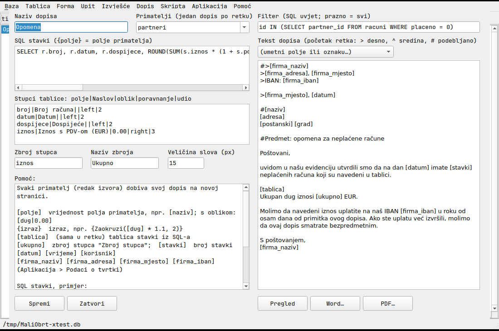
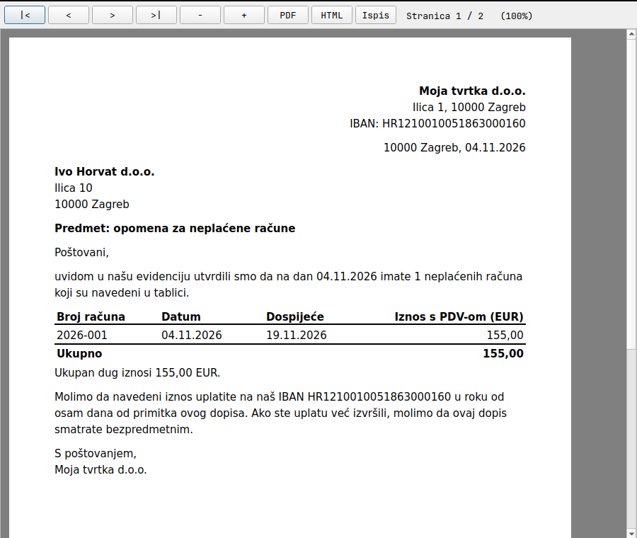

# Dopisi





**Dopis** je tekst s poljima i tablicom, kao Wordov „spajanje korespondencije”: za svaki redak izvora (primatelja) program složi jedan dopis na novoj stranici.
Tipičan primjer je **opomena**: svakoj firmi koja duguje ide dopis s popisom neplaćenih računa (broj, datum, dospijeće, iznos) i ukupnim iznosom.
Isti dopis možeš pregledati, ispisati, spremiti kao **PDF** ili **Word (.docx)** koji se dalje uređuje u Wordu ili LibreOffice Writeru.

Dopisi imaju vlastitu karticu **Dopisi** i izbornik **Dopis**: *Novi dopis…*, *Uredi dopis*, *Pregled*, *Spremi kao Word (.docx)…*, *Spremi kao PDF…*, *Obriši dopis*.

## Što se zadaje

| Polje | Značenje |
|---|---|
| **Primatelji** | tablica ili spremljeni upit; jedan dopis po retku |
| **Filter** | SQL uvjet koji bira primatelje, npr. `id IN (SELECT partner_id FROM racuni WHERE placeno = 0)` (samo firme s neplaćenim računima) |
| **SQL stavki** | upit koji daje retke tablice u dopisu; `{polje}` je vrijednost polja primatelja, npr. `WHERE partner_id = {id}` |
| **Stupci tablice** | po jedan redak `polje|Naslov|oblik|poravnanje|udio`; oblik npr. `0.00`, poravnanje `left`/`right`/`center`, udio je relativna širina stupca. Prazno = svi stupci upita |
| **Zbroj stupca** | stupac čiji se zbroj ispisuje u zadnjem retku tablice i kao `[ukupno]` |
| **Tekst dopisa** | tekst s oznakama iz sljedeće tablice |

## Oznake u tekstu

| Oznaka | Daje |
|---|---|
| `[polje]` | vrijednost polja primatelja (datumi se ispisuju kao `dd.mm.gggg`) |
| `[polje|0.00]` | isto s oblikom |
| `{izraz}` | rezultat izraza, npr. `{Zaokruzi([dug] * 1.1, 2)}` |
| `[tablica]` | (sama u retku) tablica stavki |
| `[ukupno]` | zbroj stupca *Zbroj stupca* (oblik `0.00`) |
| `[stavki]` | broj redaka tablice |
| `[datum]`, `[vrijeme]`, `[korisnik]` | današnji datum, vrijeme, prijavljeni korisnik |
| `[firma_naziv]`, `[firma_adresa]`, `[firma_mjesto]`, `[firma_iban]` | podaci iz *Aplikacija → Podaci o tvrtki* |

Početak retka: `>` poravna udesno, `^` na sredinu, `#` podebljava (mogu se kombinirati, npr. `#>`). Prazan redak je razmak. Dug redak se sam prelama.
Ako tablica ne stane na stranicu, nastavlja se na sljedeću s ponovljenim zaglavljem.

## Primjer: opomena

```
#>[firma_naziv]
>[firma_adresa], [firma_mjesto]

#[naziv]
[adresa]
[postanski] [grad]

#Predmet: opomena za neplaćene račune

Poštovani,

na dan [datum] imate [stavki] neplaćenih računa:
[tablica]
Ukupan dug iznosi [ukupno] EUR.

S poštovanjem,
[firma_naziv]
```

SQL stavki: `SELECT broj, datum, dospijece, iznos FROM racuni WHERE partner_id = {id} AND placeno = 0 ORDER BY datum`.
Stupci: `broj|Broj računa||left|2`, `datum|Datum||left|2`, `dospijece|Dospijeće||left|2`, `iznos|Iznos (EUR)|0.00|right|3`. Zbroj stupca: `iznos`.

Gotov primjer je u *Baza → Nova: primjer s blokovima (mali obrt)…*: dopis **Opomena** (dvije firme, prva s jednim, druga s četiri neplaćena računa), gumbi *Opomene dužnicima (pregled)* i *Opomene u Word* na glavnom izborniku.

## Word i PDF

* **Word (.docx):** tekst i tablica ostaju uredljivi (naslovi, poravnanje, podebljano, tablica sa zaglavljem i zbrojem); svaki primatelj počinje novom stranicom. Isprobano s LibreOfficeom.
* **PDF** i **HTML:** isti izgled kao pregled; font DejaVu Sans.
* Iz makroa: `exportletter: Opomena > datoteka.docx` (ili `.pdf`, `.html`), `openletter: Opomena`; za jednog primatelja `Opomena@ključ`, gdje je ključ vrijednost **prvog polja** izvora primatelja (obično `id`).

## Napomene

* Dopis je spremljen u bazi (kartica *Dopisi*) i ide s njom: sigurnosna kopija, kopiranje na poslužitelj.
* Iznosi se računaju u SQL-u stavki: pravila zaokruživanja PDV-a i zateznih kamata provjeri s računovođom prije slanja opomena.
* Uređivač pri *Pregled*, *Word…* i *PDF…* prvo sprema dopis.
