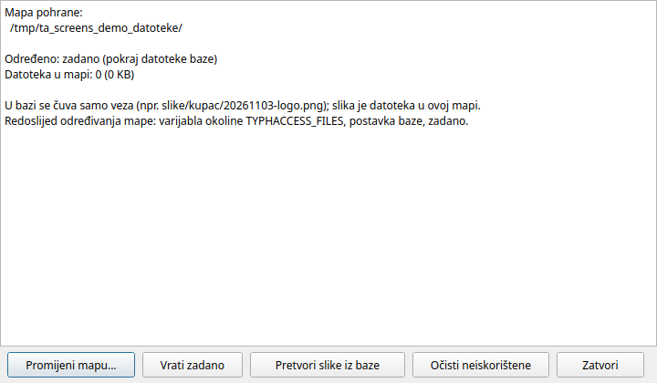
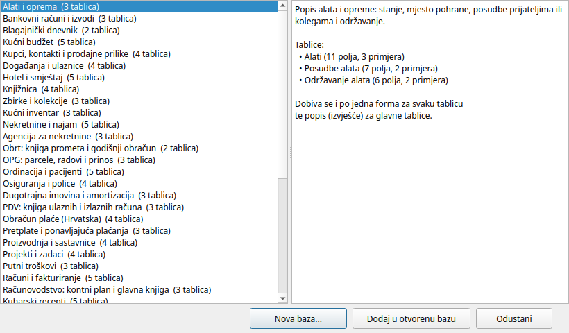
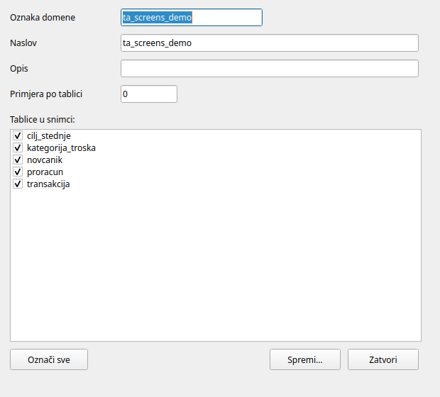

# Baze, podaci i datoteke

## Tipovi polja

Svako polje ima **logički tip** koji određuje kako se unosi, prikazuje i sprema.

| Tip | Sprema se kao | Prikaz i unos |
|---|---|---|
| `Text` | tekst | |
| `Memo` | dulji tekst | višeredni unos |
| `Integer` | cijeli broj | |
| `Decimal` | decimalni broj | zadani broj decimala (`Decimale`) |
| `Currency` | decimalni broj | zadano `#,##0.00 €`, zaokruženo na decimale |
| `YesNo` | 0/1 | kvačica; prikaz *Da*/*Ne* |
| `Date` | `yyyy-mm-dd` | `dd.mm.yyyy`; unos prihvaća `1.2.2026`, `01/02/2026`, `2026-02-01` |
| `Time` | `hh:nn:ss` | `hh:nn` |
| `DateTime` | `yyyy-mm-dd hh:nn:ss` | `dd.mm.yyyy hh:nn` |
| `AutoNumber` | cijeli broj | broji se sam; primarni ključ |
| `Picture` | **veza** na datoteku (tekst) | slika; vidi „Slike i datoteke” |

Uz tip, polje ima: **format** (uzorak iz poglavlja Izrazi), **decimale**, **zadanu vrijednost** (izraz), **oznaku** u formama, **opis** (savjet), **širinu u mreži**, **provjeru unosa** (izraz s `[value]` i poruku), oznake **primarni ključ** i **obavezno**, te **vezu** na drugu tablicu (polje, `Pri brisanju`: `NO ACTION`, `CASCADE`, `SET NULL`, `RESTRICT`). Sve se čuva u bazi, pa isti opis vrijedi u formama, izvješćima, uvozu i svim klijentima.

## Baze podataka

| Baza | Otvaranje | Napomena |
|---|---|---|
| **SQLite** | *Baza → Otvori…* ili `typhaccess baza.db` | jedna datoteka; lokalni rad; zadano |
| **PostgreSQL** | *Baza → Spoji na poslužitelj…* ili `--pg=host:port/baza/korisnik` | lozinka u dijalogu ili `PGPASSWORD` |
| **MariaDB / MySQL** | isto ili `--maria=host:port/baza/korisnik` | lozinka u `MYSQL_PWD`; poslužitelj mora raditi s `lower_case_table_names=1` |

Isti objekti (tablice, forme, izvješća, makroi) rade na sva tri sustava: izrazi se prevode u SQL dijalekt baze, a revizijski trag koristi okidače. Razlike na koje treba paziti: MariaDB ne podržava vraćanje izmjena strukture tablice (DDL nije transakcijski), a izmjene tablica u Postgresu s velikim i malim slovima u nazivima nisu podržane — nazivi se čuvaju malim slovima.

### Kopiranje baze na poslužitelj

*Baza → Kopiraj ovu bazu na poslužitelj…* prebacuje cijelu otvorenu bazu u **praznu** bazu na Postgresu ili MariaDB-u: tablice (tipovi, ključevi), podatke, veze, opise polja, forme, izvješća, upite, makroe, module, postavke, korisnike i prava, te datoteke iz mape pohrane. Revizijski trag se ne prenosi. Ako podaci krše neku vezu, tablice se kopiraju, a veza se ne postavi i dobiješ upozorenje.

## Slike i datoteke

U bazi su **samo veze**; datoteke su u mapi pohrane.

* Zadano za SQLite: mapa `<ime baze>_datoteke` pokraj datoteke baze.
* Za poslužiteljske baze zadano je mapa u profilu korisnika, koja se ne dijeli — za rad više korisnika postavi **dijeljenu mapu** (mrežni disk, NFS/SMB).
* Redoslijed određivanja mape: varijabla okoline `TYPHACCESS_FILES` (po računalu, korisno kad su putovi različiti), postavka baze `pohrana.mapa` (apsolutni put ili put prema datoteci baze), zadano.
* Veza je relativna prema mapi (`slike/kupac/20261103-logo.png`), pa baza i mapa uvijek putuju zajedno. Dopuštene su i vanjske veze: apsolutni put i `file://`; `http(s)` adrese se čuvaju, ali se slika s weba ne prikazuje.
* Veze koje izlaze iz mape (`..`) se odbijaju.
* *Baza → Pohrana datoteka…* pokazuje mapu, odakle je određena, broj i veličinu datoteka; nudi **Promijeni mapu…** (postojeće datoteke treba ručno premjestiti), **Vrati zadano** i **Pretvori slike iz baze** (stare BLOB slike postaju datoteke i veze, uz očuvan opis polja; isto tako slike ugrađene u forme i izvješća postaju datoteke u `slike/_forme` i `slike/_izvjesca`; preporučuje se prvo sigurnosna kopija).
* **Očisti neiskorištene** traži datoteke u pohrani koje nijedna veza ne koristi (ni polje Picture ni slika u formi ili izvješću), pokaže popis i, nakon potvrde, **premješta** ih u podmapu `_neiskoristeno` (ništa se ne briše; mapu možeš obrisati kad si siguran). Pazi: datoteke koje koristiš drugdje (npr. iz 4GL programa) također će biti na popisu.
* **Sigurnosna kopija** uz bazu sprema i mapu (`…_datoteke`); **izvoz aplikacije** i **kopiranje na poslužitelj** također prenose datoteke.

## Katalog shema

*Baza → Nova: primjer-baza iz kataloga…* nudi 42 gotove domene (računi, skladište, plaće, PDV knjige, recepti, kućni budžet, knjižnica, škola, ordinacija, udruga, stambena zgrada, veterina, OPG, liga…) s tablicama, vezama, podacima za primjer, formama i popisima. Domena se može napraviti kao nova baza ili dodati u otvorenu (tablice koje već postoje se preskaču). U dijalogu nove tablice **Polje iz kataloga…** i **Tablica iz kataloga…** daju gotova polja: tip, format, provjera i opis postavljaju se sami, a uz svako polje piše gdje se još pojavljuje. *Baza → Katalog shema: dokumentacija (HTML)* piše cjelovit popis polja. *Tablica → Dopuni rječnik polja iz kataloga* isto čini za postojeću tablicu: polja čiji se naziv podudara s poljem iz kataloga (npr. `email`, `iznos`, `oib`) dobivaju oznaku, opis, format, provjeru unosa i širinu, ali samo tamo gdje je to svojstvo još prazno; tip polja se ne mijenja, a polja čija se vrsta ne slaže s katalogom se preskaču. Isto se po želji radi pri uvozu u novu tablicu (kvačica *Oznake, opisi i provjere iz kataloga*). 

*Baza → Katalog shema: snimka ove baze u domenu…* radi obrnuto: iz tablica otvorene baze (SQLite, Postgres ili MariaDB) izrađuje datoteku domene (JSON) s tipovima, vezama, rječnikom polja i, po želji, prvih nekoliko redaka kao primjer. Uloge polja (naziv, iznos, datum, kontakt…) program pogađa iz tipa i naziva, a opise koje nisu upisani zamjenjuje oznakom polja, pa ih dopuni ručno. Veze na tablice izvan snimke se izostavljaju, a veze u primjerima koje uzorak ne pokriva ostaju prazne. Datoteka se prije spremanja provjerava istom provjerom kao ugrađene domene; spremi je u mapu `catalog/` pokraj programa pa se učitava pri idućem pokretanju. Format datoteka kataloga opisan je u `catalog/README.md`; vlastite domene stavljaju se u mapu `catalog/` pokraj programa.

## Uvoz i izvoz

* *Baza → Uvoz (CSV, Excel)…* čita CSV ili Excel datoteku u tablicu.
* *Baza → Izvoz (CSV, Excel, JSON)…* piše tablicu ili upit.
* Forma može izvesti svoj prikaz u CSV naredbom `export`.

## Održavanje

* **Relacije** — pregled i uređivanje veza među tablicama.
* **Provjeri i sažmi bazu** — provjera cjelovitosti i sažimanje SQLitea.
* **Alati za podatke** (*Upit → Alati za podatke…*) — traži/zamijeni po stupcu, pronalaženje duplikata, probni prolaz prije izmjene.
* **Revizijski trag** — uključuje se po tablici; bilježi umetanje, izmjenu i brisanje s korisnikom, vremenom i starom/novom vrijednošću.
* **Planer zadataka** — sigurnosna kopija baze, izvješće u PDF, izvoz u CSV, SQL naredba ili makro po rasporedu; izvodi se i bez prozora s `typhaccess --run-tasks baza.db` (npr. iz `cron`-a).

## Korisnici i prava

Dok nema korisnika, svi su administratori. Čim se doda prvi korisnik, traži se prijava. Uloge: `viewer` (samo čita), `user` (unosi podatke, pokreće forme, izvješća i makroe), `admin` (sve, uključujući dizajn). *Prava objekata* postavljaju najnižu ulogu koja smije otvoriti pojedinu formu, izvješće ili makro. Lozinke se u bazi ne čuvaju kao tekst nego kao sažetak (hash).

## Podaci o tvrtki i uplatnice

*Podaci o tvrtki* koriste računi i HUB-3 uplatnice.
