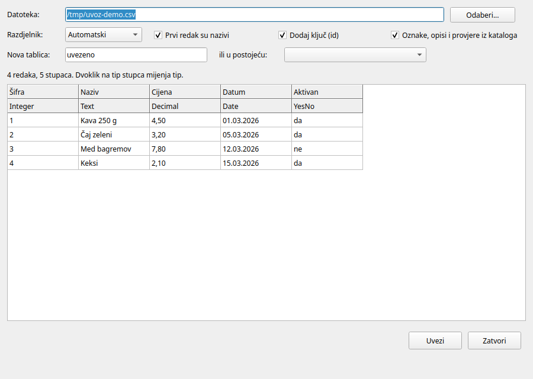
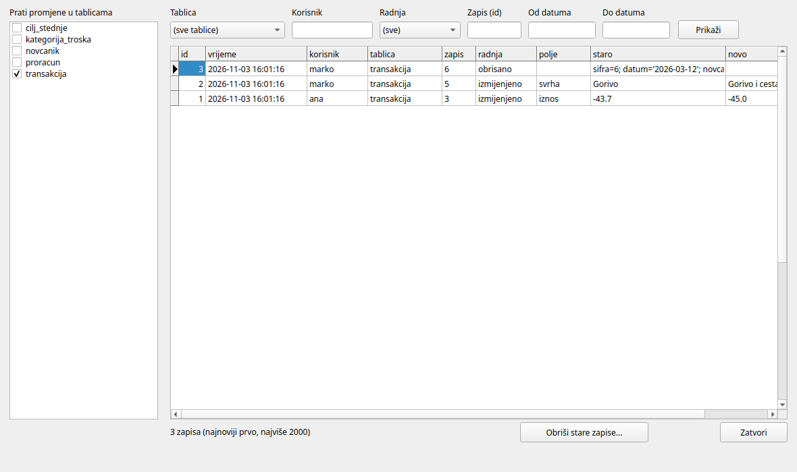
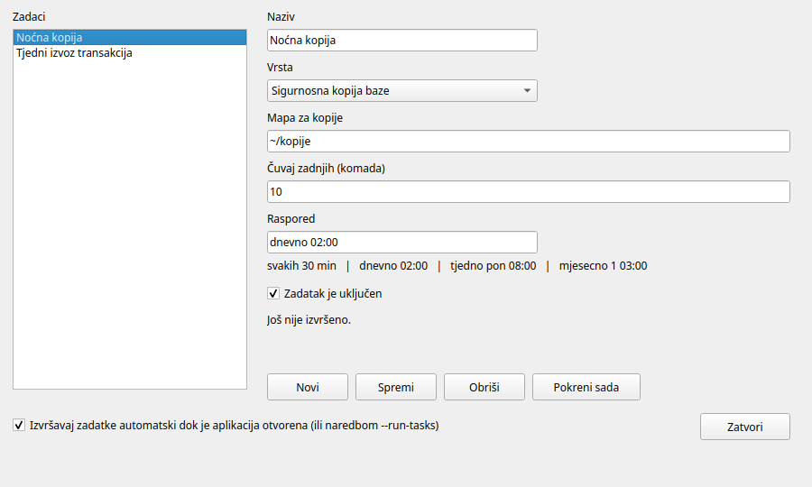
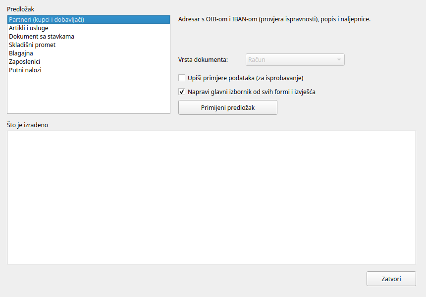
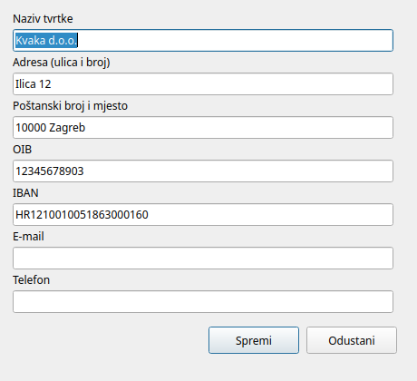

# Uvoz, izvoz, revizija, planer i poslovni predlošci

Ovo poglavlje opisuje izbornike koji nisu vezani uz jedan objekt: razmjenu podataka s drugim programima, praćenje promjena, automatske zadatke, gotove poslovne predloške i fiskalizaciju.

## Uvoz podataka

*Baza → Uvoz (CSV, Excel)…* čita datoteku i stavlja je u novu ili postojeću tablicu.

Podržane datoteke: `.csv`, `.txt`, `.tsv`, `.xlsx`, `.xls`, `.ods`. Za Excel i ODS uvozi se prvi list.



### Koraci

1. **Odaberi…** datoteku. Odmah se pokaže pregled prvih 30 redaka.
2. **Razdjelnik** (samo za tekstualne datoteke): *Automatski* prepoznaje `;`, `,`, tabulator ili `|`; po potrebi ga zadaj ručno. Hrvatski Excel sprema CSV sa `;`.
3. **Prvi redak su nazivi** — ako je uključeno, prvi redak postaje nazivi polja.
4. Odredi odredište:
   * **Nova tablica** — upiši naziv (predložen je iz imena datoteke). Ako tablica s tim nazivom već postoji, uvoz se odbija s porukom.
   * **ili u postojeću** — odaberi tablicu s popisa; nova tablica se tada ne stvara.
5. **Dodaj ključ (id)** (samo za novu tablicu) — dodaje polje `id` tipa AutoNumber kao primarni ključ. Ako datoteka već ima stupac `id`, ključ se ne dodaje.
6. **Uvezi.** Javlja broj uvezenih redaka, preskočenih redaka i neispravnih vrijednosti.

### Prepoznavanje tipova (nova tablica)

Program pregleda sve vrijednosti stupca i bira prvi tip koji svima odgovara: `Integer`, `Decimal` (broj decimala prema podacima, najviše 4), `Date`, `DateTime`, `Time`, `YesNo`, `Memo` (ako ima tekstova duljih od 255 znakova), inače `Text`. Datumi se prepoznaju u zapisima `31.12.2026`, `31/12/2026` i `2026-12-31`; brojevi u hrvatskom (`1.234,56`) i uobičajenom (`1,234.56`) zapisu.

U pregledu je ispod naziva stupca njegov tip. **Dvoklik na tip** ga mijenja (npr. šifre koje izgledaju kao brojevi, a treba ih čuvati kao `Text` zbog vodećih nula).

### Uvoz u postojeću tablicu

* Ako je uključeno *Prvi redak su nazivi*, stupci se spajaju s poljima tablice **po nazivu** (velika i mala slova nisu važna). Stupci kojih nema u tablici preskaču se; polja kojih nema u datoteci ostaju prazna (ili dobiju zadanu vrijednost baze).
* Bez naziva stupci se spajaju **po položaju**: prvi stupac u prvo polje i tako redom.
* Vrijednosti se pretvaraju prema tipu polja i njegovu formatu, pa polje `Date` prihvaća datum u bilo kojem od gornjih zapisa.

### Što se događa s lošim podacima

* Vrijednost koja se ne da pretvoriti u tip polja ostavlja se **praznom** i broji se kao „neispravna vrijednost”.
* Redak koji baza odbije (npr. dvostruki ključ, narušena veza, obavezno polje prazno) **preskače se** i broji kao „preskočen”.
* Cijeli uvoz je jedna transakcija: ako se prekine greškom, ništa se ne upisuje.

Uvoz **ne primjenjuje** provjere unosa (`Provjera unosa`) polja. Nakon velikog uvoza korisno je pokrenuti upit koji traži čudne vrijednosti (npr. `iznos < 0`).

## Izvoz podataka

*Baza → Izvoz (CSV, Excel, JSON)…* izvozi tablicu ili spremljeni upit.

| Format | Napomena |
|---|---|
| **CSV (;)** | za hrvatski Excel; UTF-8 sa oznakom BOM (Excel ispravno čita hrvatska slova) |
| **CSV (,)** | za programe koji očekuju zarez |
| **Excel (.xlsx)** | jedan list; brojevi i datumi su pravi brojevi i datumi (datum `dd.mm.yyyy`), ne tekst |
| **JSON** | polje objekata, jedan objekt po retku; brojevi su brojevi, prazno je `null` |

Izvor je bilo koja tablica ili spremljeni upit, pa se izvoz može ograničiti upitom (filtar, zbrojevi, samo potrebna polja). Parametarski upiti traže vrijednosti prije izvoza. Za automatski izvoz po rasporedu vidi *Planer zadataka*.

Prikaz forme može se izvesti u CSV i naredbom makroa `export` (poglavlje o makroima).

## Revizijski trag

*Aplikacija → Revizijski trag…* bilježi **tko je, kada i što promijenio** u odabranim tablicama.



### Uključivanje

U lijevom popisu *Prati promjene u tablicama* kvačicom označi tablice koje se prate. Za svaku se u bazi stvaraju okidači (triggeri), pa se promjene bilježe **bez obzira kako nastaju**: iz forme, uvoza, upita, makroa, 4GL-a ili drugog programa spojenog na istu bazu. Isključivanje kvačice uklanja okidače; stari zapisi ostaju.

Zapisi su u sistemskoj tablici `_sys_audit` (ne prati se sama).

### Što se bilježi

| Radnja | Zapis |
|---|---|
| dodano | **jedan** redak s cijelim novim zapisom u obliku `polje=vrijednost; polje=vrijednost; …` |
| izmijenjeno | jedan redak po **promijenjenom** polju: staro i novo |
| obrisano | **jedan** redak s cijelim obrisanim zapisom u istom obliku (da se može vratiti) |

Svaki zapis ima vrijeme, korisnika, tablicu, ključ retka (`id`) i radnju; kod izmjene i naziv polja. Slike (BLOB polja) bilježe se kao `(slika)`.

Korisnik je prijavljeni korisnik programa. Ako korisnici nisu postavljeni, uzima se korisnik operacijskog sustava.

### Pregled

Desni dio prozora je tablica zapisa, najnoviji prvi (najviše 2000). Filtri: **Tablica**, **Korisnik** (dio imena), **Radnja**, **Zapis (id)**, **Od datuma** i **Do datuma**; **Prikaži** osvježava pogled. Tipičan upit: „tko je promijenio račun 1042?” — tablica `racun`, zapis `1042`.

**Obriši stare zapise…** briše zapise starije od zadanog broja dana. Revizijski trag brzo raste na tablicama koje se često mijenjaju; zato pratiš samo ono što je važno (iznosi, cijene, računi, plaće), a ne šifrarnike.

Revizijski trag **ne prenosi** se pri *Kopiraj ovu bazu na poslužitelj*.

## Planer zadataka

*Aplikacija → Planer zadataka…* izvodi poslove po rasporedu. Zadaci se spremaju u bazu (`_sys_tasks`).



### Vrste zadataka

| Vrsta | Prvi podatak | Drugi podatak | Što radi |
|---|---|---|---|
| **backup** (kopija baze) | mapa za kopije | koliko zadnjih kopija čuvati (zadano 10) | stvara `ime_yyyymmdd_hhnnss.db` i briše starije od zadnjih *n*; **samo SQLite** |
| **report_pdf** | izvješće | mapa za PDF | piše `izvjesce_yyyymmdd.pdf` |
| **export_csv** | tablica ili upit | mapa za CSV | piše `naziv_yyyymmdd.csv` (razdjelnik `;`) |
| **sql** | SQL naredba | — | izvodi naredbu (npr. čišćenje starih redaka) |
| **macro** | naziv makroa | — | pokreće makro iz baze |

Mape se po potrebi stvaraju. Kopija baze koristi `VACUUM INTO`, pa je dosljedna i dok je baza otvorena. Zadatak *backup* radi samo na SQLite bazi; za Postgres i MariaDB kopiju radi poslužitelj (njegovi vlastiti alati), a ostale vrste zadataka rade na svim bazama.

### Raspored

Raspored se piše riječima:

| Zapis | Značenje |
|---|---|
| `svakih 30 min` | svakih 30 minuta (`h` ili `sati` za sate: `svakih 2 h`) |
| `dnevno 02:00` ili `svaki dan 02:00` | svaki dan u 02:00 |
| `tjedno pon 08:00` | svaki tjedan; dani: `pon`, `uto`, `sri`, `cet`, `pet`, `sub`, `ned` |
| `mjesecno 1 03:00` | svakog 1. u mjesecu u 03:00 (dan 1 do 31) |

Zadatak je **na redu** kad je od zadnjeg izvršavanja prošao termin rasporeda. Ako je računalo bilo ugašeno u 02:00, zadatak će se izvršiti čim se program pokrene, ali samo jednom (ne za svaki propušteni termin).

### Rad s popisom

* **Novi** čisti obrazac, **Spremi** sprema (raspored se provjerava i greška se odmah javlja), **Obriši** uklanja zadatak.
* **Pokreni sada** odmah izvodi odabrani zadatak, neovisno o rasporedu.
* *Zadatak je uključen* privremeno isključuje zadatak bez brisanja.
* Ispod obrasca piše kad je zadatak zadnji put izvršen i s kojim ishodom (`OK: …` ili `GREŠKA: …`).

### Kako se izvršava

* Dok je program otvoren, svake minute provjerava što je na redu (kvačica *Izvršavaj zadatke automatski dok je aplikacija otvorena*).
* Bez prozora: `typhaccess --run-tasks baza.db` izvrši što je na redu, ispiše ishod u terminal i izađe. To je način za poslužitelj ili `cron`:

```
# svakih 15 minuta
*/15 * * * *  /opt/typhaccess/typhaccess --run-tasks /podaci/firma.db
```

Cron mora pokretati naredbu češće ili jednako često kao što je najčešći raspored.

## Poslovni predlošci

*Aplikacija → Poslovni predlošci…* u otvorenu bazu doda gotove tablice, forme, izvješća, upite i pravila za čest posao. Što je napravljeno, ispiše se u donjem polju.

| Predložak | Što dobiješ |
|---|---|
| **Partneri (kupci i dobavljači)** | adresar s OIB-om i IBAN-om (provjera ispravnosti pri unosu), popis i naljepnice |
| **Artikli i usluge** | šifrarnik s cijenom, PDV stopom i jedinicom mjere, cjenik |
| **Dokument sa stavkama** | zaglavlje i stavke za **Račun, Ponudu, Narudžbenicu, Otpremnicu ili Predračun** (vrsta se bira u dijalogu); odabir artikla upisuje cijenu; ukupno s PDV-om; ispis |
| **Skladišni promet** | primke i izdatnice sa stavkama; izvješće o stanju zaliha |
| **Blagajna** | uplate i isplate; blagajnički dnevnik s tekućim saldom |
| **Zaposlenici** | popis s godinama i stažem (izračunato), plaće po odjelima |
| **Putni nalozi** | putni nalog s izračunom troškova (km, dnevnice) i ispisom |



Opcije:

* **Upiši primjere podataka** — za isprobavanje; za dokument upisuje i primjer podataka o tvrtki ako ih još nema.
* **Napravi glavni izbornik od svih formi i izvješća** — gradi početnu formu s gumbima.

Predlošci su običan sadržaj baze: sve što dobiješ možeš mijenjati u dizajnerima. Ako tablica već postoji, predložak je ne prepisuje nego ju koristi, pa je siguran i na bazi u kojoj već radiš.

### Podaci o tvrtki



*Aplikacija → Podaci o tvrtki…* sprema naziv, adresu, poštanski broj i mjesto, OIB, IBAN, e-mail i telefon. Predlošci i uplatnice ih čitaju kao postavke (`firma.naziv`, `firma.adresa`, `firma.mjesto`, `firma.iban`…) funkcijom `Postavka("firma.naziv")`, pa se podaci unose samo jednom.

