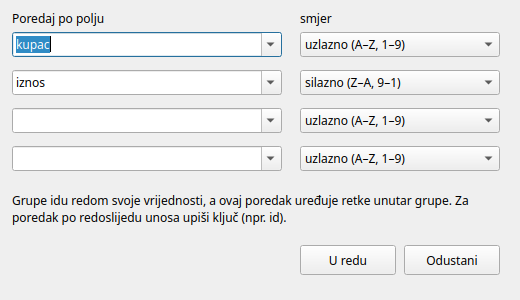
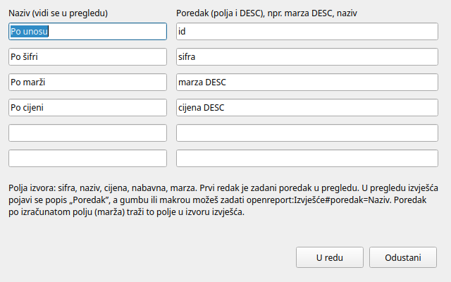
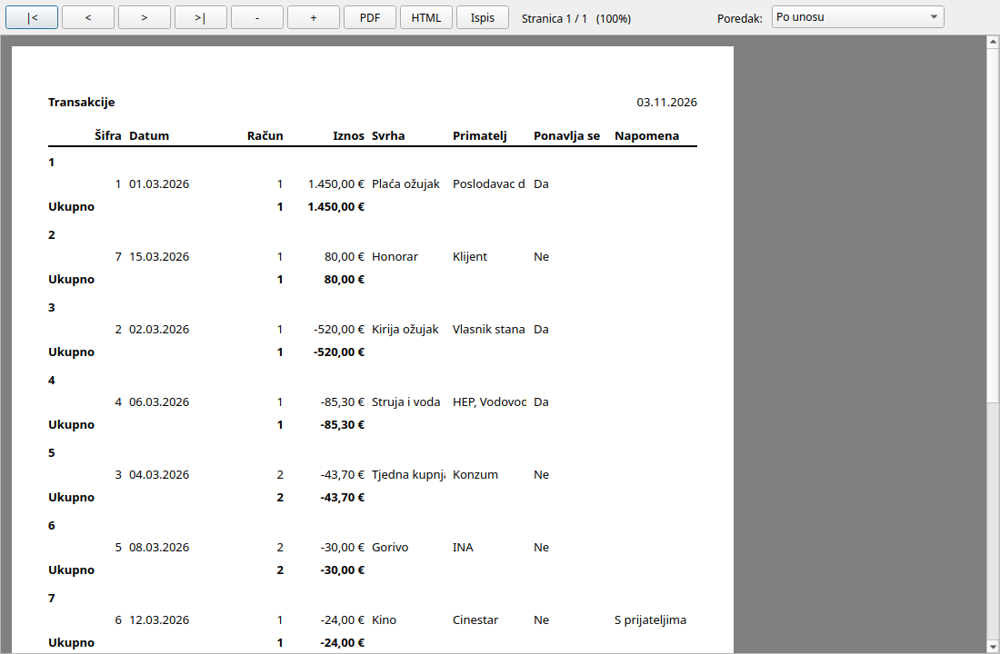
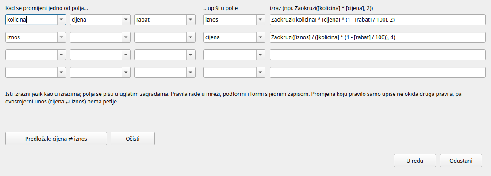

# Kako da… (recepti)

Kratki recepti za stvari koje se stalno traže. Svaki recept je provjeren testom programa (primjeri su isti kao u testu). Primjeri
govore o računu sa stavkama: tablica `racun` (zaglavlje), `racun_stavka` (stavke) i `artikl` (šifrarnik).

**Kazalo:** [redni broj stavke](#redni-broj-stavke) · [redoslijed ispisa](#redoslijed-ispisa-po-unosu-šifri-nazivu) ·
[cijena iz artikla u stavku](#cijena-iz-artikla-u-stavku-računa) · [unos iznosa pa cijena se preračuna](#unos-iznosa-pa-se-cijena-preračuna) ·
[ukupni iznosi koji štimaju](#ukupni-iznosi-koji-štimaju-zaokruživanje-i-pdv) · [zbroj stavki na glavnoj formi](#zbroj-stavki-na-glavnoj-formi) ·
[broj računa po godini](#broj-računa-po-godini) · [stanje zalihe](#stanje-zalihe) ·
[ovisni (kaskadni) popisi](#ovisni-kaskadni-popisi) · [zaključavanje knjiženog dokumenta](#zaključavanje-knjiženog-dokumenta)

**Izvješća:** [zbroj grupe i ukupno](#zbroj-grupe-i-ukupni-zbroj) · [udio u ukupnom](#udio-grupe-u-ukupnom-iznosu) · [tekući saldo](#tekući-saldo) ·
[zbroj samo plaćenih](#zbroj-samo-plaćenih-uvjetni-zbroj) · [stranica N / M](#stranica-n--m) · [grupa na novoj stranici](#svaka-grupa-na-novoj-stranici) ·
[isti izvještaj u više poredaka](#isti-izvještaj-u-više-poredaka-po-unosu-šifri-marži-cijeni) · [ispis jednog dokumenta](#ispis-samo-jednog-dokumenta) · [naljepnice u stupcima](#naljepnice-u-stupcima)

**Forme:** [zadana vrijednost](#zadana-vrijednost-polja) · [obavezno i provjera unosa](#provjera-unosa-s-porukom) · [OIB](#provjera-oiba) · [izračunata kontrola](#izračunata-kontrola-na-formi) ·
[uvjetno prikazivanje](#uvjetno-prikazivanje-kontrole) · [kopiranje zapisa](#kopiranje-zapisa)

**Podaci i sustav:** [uvoz CSV-a](#uvoz-csv-a-s-hrvatskim-brojevima-i-datumima) · [izvoz za Excel](#izvoz-za-excel) · [sigurnosna kopija](#automatska-sigurnosna-kopija) ·
[tko je što promijenio](#tko-je-što-promijenio) · [zaokruživanje gotovine](#zaokruživanje-gotovine-na-005) · [dospijeće i dani kašnjenja](#dospijeće-i-dani-kašnjenja)

## Redni broj stavke

**Problem:** u izvješću uz svaku stavku treba stajati 1, 2, 3…

**Rješenje:** u odjeljak `Detail` stavi `TextBox` s izvorom

* `=GroupRow` — redni broj **unutar grupe** (u svakoj grupi počinje od 1), ili
* `=RowNum` — redni broj kroz **cijelo izvješće**.

(`=RunGCount(*)` i `=RunCount(*)` daju isto kao dvije varijable.) Ako izvješće nema grupe, oba daju isto. Redoslijed brojeva prati redoslijed ispisa (vidi sljedeći recept).
`GroupRows` je broj redaka grupe, a `RowCount` broj redaka izvješća, pa je „3 / 12” `=GroupRow & " / " & GroupRows`.

**Napomena:** u Accessu se isto radi tekstualnom kontrolom `=1` sa svojstvom „Running Sum”; ovdje je dovoljna funkcija.

## Redoslijed ispisa: po unosu, šifri, nazivu

**Problem:** dokument treba ispisati po redoslijedu unosa, po šifri ili po nazivu.

**Rješenje:** u dizajneru izvješća postavi svojstvo `SortBy` (gumb **Poredak…** u drugoj traci alata otvara dijalog s do četiri polja i smjerom uzlazno/silazno; ili upiši tekst):




| Što želiš | `SortBy` |
|---|---|
| po redoslijedu unosa | `id` (ključ koji se sam broji; baza bez poretka ne jamči ništa, osobito Postgres) |
| po šifri | `sifra` |
| po nazivu | `naziv` |
| po nazivu, istovjetni po šifri | `naziv, sifra` |
| od najvećeg iznosa | `iznos DESC` |

Ako izvješće ima grupu (`GroupField`), grupe idu redom svoje vrijednosti, a `SortBy` uređuje stavke **unutar** grupe. Izvješće
slaže samo po `GroupField`, pa po `SortBy`; za redoslijed zato ne računaj na `ORDER BY` iz upita.

## Isti izvještaj u više poredaka (po unosu, šifri, marži, cijeni)

**Problem:** kalkulaciju treba isprintati u više poredaka: po unosu, po šifri, po marži, po cijeni. To je isto izvješće, samo s drugačijim poretkom;
kopija izvješća za svaki poredak bi se morala održavati sva četiri puta.

**Rješenje:** jedno izvješće s **ponuđenim poredcima**.

1. U izvor izvješća (upit) stavi polje po kojem želiš slagati, uključujući izračunato. Primjer za maržu:
   `SELECT *, ROUND((cijena - nabavna) / cijena * 100, 2) AS marza FROM kalkulacija`.
2. U dizajneru izvješća, ne označavajući nijednu stavku, uz svojstvo **SortOptions** klikni **…** i upiši nazive i poretke:



| Naziv | Poredak |
|---|---|
| Po unosu | `id` |
| Po šifri | `sifra` |
| Po marži | `marza DESC` |
| Po cijeni | `cijena DESC` |

3. U **pregledu** izvješća pojavi se popis **Poredak**; promjena odmah ponovo slaže stranice, a **PDF** i **Ispis** rade u odabranom poretku:



4. Iz gumba ili makra otvori izvješće odmah u željenom poretku: `openreport:Kalkulacija#poredak=Po marži`
   (s filterom: `openreport:Kalkulacija#poredak=Po marži@"id = " & [id]`).

Provjereno na četiri retka: po unosu, po šifri, po marži (najveća prva) i po cijeni (najveća prva) daju četiri različita redoslijeda, a promjena poretka u pregledu stvarno
ponovo slaže izvješće. Poredak po izračunatom polju upita (marža) također radi.

**Napomene:** bez `SortBy`-a prvi redak popisa je zadani poredak u pregledu; ako izvješće ima `SortBy`, vrijedi on, a popis je prazan dok ne odabereš poredak. Ako izvješće ima **grupu**
(`GroupField`), grupe i dalje idu prvom, a odabrani poredak uređuje retke unutar grupe.

## Cijena iz artikla u stavku računa

**Problem:** u stavci računa odabereš artikl i želiš da se sama upiše cijena (i naziv, jedinica, PDV).

**Rješenje:** na podformi stavki (ili na formi u obliku mreže) postavi svojstvo `AutoFill`. Gumb **…** pokraj svojstva otvara pomoćnik; pravilo izgleda ovako:

```
artikl_id>artikl.sifra:cijena=cijena,opis=naziv,jmj=jmj,pdv_stopa=pdv_stopa
```

Čitaj: kad se promijeni `artikl_id`, uzmi redak iz `artikl` s ključem `sifra` i prekopiraj `cijena` u `cijena`, `naziv` u `opis` itd.

**Kraće, za jedno polje:** funkcija `Preuzmi(tablica, polje, ključ)` uzima vrijednost iz retka s tim primarnim ključem, bez pisanja uvjeta.
Umjesto `DLookup("cijena", "artikl", "sifra = '" & [artikl_id] & "'")` dovoljno je `=Preuzmi("artikl", "cijena", [artikl_id])`.
Provjereno: ključ `A-1` daje cijenu 0,35; prazan ključ daje prazno polje (bez greške); apostrof u vrijednosti ne smeta. Kao zadana vrijednost ili izračunata kontrola
koristi se za prikaz; za **snimku** cijene u stavci ipak koristi `AutoFill`.

**Zašto se kopira, a ne čita uživo:** cijena u stavci je **snimka** na dan računa. Kad se cijena artikla kasnije promijeni, stari računi ostaju točni.

**Gdje radi:** u mreži (forma u obliku mreže i podforma) i u formi s jednim zapisom (pokreće ga promjena kontrole vezane uz polje-okidač).

## Unos iznosa pa se cijena preračuna

**Problem:** iznos stavke na računu razlikuje se od komadne cijene × količine za nekoliko lipa/centa, a važno je da **iznos štima**. Treba moći upisati
iznos pa da se cijena preračuna.

**Rješenje:** polju `iznos` u tablici stavki daj tip *Currency* (2 decimale), a `cijena` tip *Decimal* s **4 decimale**. Na podformi (ili formi u obliku mreže) postavi svojstvo `CalcRules`; gumb **…** pokraj svojstva otvara pomoćnik, a gumb **Predložak: cijena ⇄ iznos** sam upiše ova dva pravila (uz `rabat` ako ga tablica ima):



Pravila izgledaju ovako:

```
kolicina,cijena,rabat -> iznos = Zaokruzi([kolicina] * [cijena] * (1 - [rabat] / 100), 2) ;;
iznos -> cijena = Zaokruzi([iznos] / ([kolicina] * (1 - [rabat] / 100)), 4)
```

Što se događa (provjereno primjerima):

| Unos | Rezultat |
|---|---|
| količina 7 × cijena 0,7528 | iznos **5,27** (da je cijena prikazana 0,75, dalo bi 5,25) |
| upišeš iznos 5,25 | cijena se preračuna na **0,7500**, iznos ostaje 5,25 |
| količina 0,333 × cijena 3,00 | iznos 1,00 (0,999 zaokruženo) |
| upišeš iznos 1,00 | cijena **3,0030** |
| količina 2, rabat 10 %, upišeš iznos 54 | cijena **30,0000** (rabat se uračuna) |

Iznos stavke je **mjerodavan**: sprema se u bazu i ispisuje se na računu, a cijena je izvedena iz njega. Pravilo koje samo upiše vrijednost ne okida druga
pravila, pa nema petlje.

## Ukupni iznosi koji štimaju: zaokruživanje i PDV

**Problem:** zbroj stavki i PDV na ekranu ne odgovaraju ispisanom računu za 0,01–0,03.

**Uzrok:** PDV zaokružen po svakoj stavci pa zbrojen daje drugi rezultat od PDV-a na zbroj osnovica. Primjer: tri stavke po 10,05 uz PDV 10 %
— po stavci 3 × 1,01 = **3,03**, na zbroj 30,15 × 10 % = 3,015 → **3,02**.

**Rješenje:**

1. Iznos stavke je zaokružen i pohranjen (prethodni recept); ukupna osnovica je njihov zbroj: `=Nz(DSum("iznos", "racun_stavka", "racun_id = " & [id]), 0)`.
2. PDV računaj funkcijom `PdvPoStopama`, koja zbroji osnovice **po stopi** i zaokruži PDV po svakoj stopi posebno:
   `=Nz(PdvPoStopama("racun_stavka", "iznos", "pdv_stopa", "racun_id = " & [id]), 0)`.
3. Ukupno = osnovica + PDV. Tako je ukupno uvijek jednako zbroju ispisanih stavki i PDV-a.

Provjereno: 3 × 10,05 uz 10 % → PDV 3,02, ukupno 33,17; 130,63 uz 20 % → 26,13; stavke 100,10 uz 25 % i 50,05 uz 5 % → 25,03 + 2,50 = 27,53.

**Zaokruživanje:** za novac koristi `Zaokruzi(x, n)`: .5 uvijek ide na veću vrijednost (1,005 → 1,01; 0,125 → 0,13). `Round` je **bankarski**
(kao u Accessu: 0,125 → 0,12), što kod novca iznenađuje.

**Napomena o propisu:** postupak je zaokruživanje PDV-a na zbroj osnovica po stopi. Je li to propisani način na računu, provjeri s računovođom.

Poslovni predložak *Dokument sa stavkama* već je postavljen ovako (iznos pohranjen, pravila izračuna, PDV po stopama).

## Zbroj stavki na glavnoj formi

**Problem:** na formi računa treba pisati ukupni zbroj stavki iz podforme.

**Rješenje:** na glavnu formu stavi `TextBox` s izvorom
`=Nz(DSum("iznos", "racun_stavka", "racun_id = " & [id]), 0)`. Računa se iz baze, pa prati nove i izmijenjene stavke čim se spreme. Nema potrebe za
referencama na podformu (u Accessu čest uzrok greške `#Name?`).

## Broj računa po godini

**Problem:** broj računa treba biti oblika `2026-001`.

**Rješenje:** polje `broj` (tekst) dobije zadanu vrijednost izrazom
`Format(Year(Today()), "0000") & "-" & Format(Nz(DMax("id", "racun", ""), 0) + 1, "000")` (to koristi predložak *Dokument sa stavkama*). Ne koristi `AutoNumber`
za službeni broj: ne može se uređivati i ostavlja rupe kad se redak obriše. Ni ova zadana vrijednost ne jamči broj bez rupa: ako se zadnji redak obriše, njegov se broj ponovo dodjeljuje samo dok ne stigne novi, a brojač se ne vraća na 1 s novom godinom.

**Napomena:** zadana vrijednost broji po ključu (`id`), ne po godini. Za brojanje koje se vraća na 1 svake godine, `DMax` treba ograničiti uvjetom na godinu
(npr. broj počinje s `2026-`) i čitati zadnji broj te godine; ako se više korisnika istodobno unosi, provjeri jedinstvenost (ograničenje `UNIQUE` na polju `broj`).

## Stanje zalihe

**Problem:** treba znati koliko artikla ima na stanju kad se roba prima i izdaje.

**Rješenje:** nemoj umanjivati polje „količina” pri svakom izdavanju. Evidentiraj **kretanja** (primka plus, izdatnica minus) i stanje **izračunaj** iz njih:
poslovni predložak *Skladišni promet* ovo već radi i ima upit `Stanje zaliha`:

```
COALESCE(SUM(CASE WHEN d.tip = 'Primka' THEN s.kolicina ELSE -s.kolicina END), 0) AS stanje
```

Primjer (provjereno): primka 500 i izdatnica 200 istog artikla daju stanje **300**.

**Zašto ne polje koje se umanjuje:** kad se kasnije ispravi količina na stavci, spremljeno stanje ostaje krivo; izračunato stanje se uvijek poklapa s dokumentima.

## Ovisni (kaskadni) popisi

**Problem:** popis gradova treba pokazivati samo gradove odabrane županije.

**Rješenje:** na formi stavi dva padajuća popisa. Prvom (`cmbZup`, polje `zupanija_id`) je `RowSource`
`SELECT id, naziv FROM zupanija ORDER BY naziv`. Drugom (`cmbGrad`, polje `grad_id`) je `RowSource` s **imenom prvog popisa u uglatim zagradama**:

```
SELECT id, naziv FROM grad WHERE zupanija_id = [cmbZup] ORDER BY naziv
```

Čim se promijeni prvi popis, drugi se sam osvježi (provjereno: županija 1 nudi dva grada, nakon odabira druge nudi tri njena grada).
U uglatim zagradama može stajati i naziv polja forme.

## Zaključavanje knjiženog dokumenta

**Problem:** račun koji je knjižen ne smije se više mijenjati.

**Rješenje:** u tablici `racun` neka postoji polje `knjizen` (Da/Ne). U modulu napiši proceduru i spoji je na događaj forme `BeforeUpdate`:

```pascal
procedure ZakljucajKnjizeno;
begin
  if SqlValue('SELECT knjizen FROM racun WHERE id = ' + GetValue('txtId')) = '1' then
  begin
    ShowMessage('Račun je knjižen i ne može se mijenjati.');
    CancelEvent;
  end;
end;
```

(`txtId` je kontrola s poljem `id`.) Provjera čita **spremljeno** stanje iz baze, pa se ne može zaobići izmjenom kontrola. Isto stavi i na `BeforeDelete` da se knjiženi račun ne može obrisati.
Za vizualni znak onemogući kontrole svojstvom `EnabledIf` (npr. `[knjizen] = 0`).

# Izvješća

Primjeri koriste tablicu `racun` s poljima `kupac`, `iznos`, `placeno` (0/1), `datum`, a izvješće je grupirano po `kupac`.

## Zbroj grupe i ukupni zbroj

**Rješenje:** u `GroupFooter` stavi `TextBox` s izvorom `=Sum([iznos])` (zbroj grupe), a u `ReportFooter` isti izraz (zbroj svega).
Zbrojevi se računaju nad opsegom odjeljka u kojem stoje.

Provjereno: grupa A (100 + 50) daje 150, grupa B (30 + 20) daje 50, ukupno 200.

## Udio grupe u ukupnom iznosu

**Rješenje:** u `GroupFooter`: `=Percent(Sum([iznos]), SumAll([iznos]))`. `SumAll` je zbroj **svih** redaka izvješća, bez obzira na grupu.
Provjereno: 150 od 200 je 75 %, 50 od 200 je 25 %.

## Tekući saldo

**Rješenje:** u `Detail`: `=RunSum([iznos])`, a `SortBy` neka bude `id` (ili datum) da redoslijed ima smisla. Provjereno: 100, 150, 180, 200.
Tekući zbroj **unutar grupe** daje `=RunGSum([iznos])`.

## Zbroj samo plaćenih (uvjetni zbroj)

**Problem:** zbrojiti samo neke retke (plaćene račune, jednu kategoriju).

**Rješenje:** zbroju možeš dati izraz umjesto polja: `=Sum(Iif([placeno] = 1, [iznos], 0))`. Provjereno: od 100, 50, 30, 20 plaćeni su 100 i 30, rezultat 130.
Isto vrijedi za brojanje: `=Sum(Iif([placeno] = 1, 1, 0))` je broj plaćenih. Izraz kao argument rade `Sum`, `Count`, `Avg`, `First`, `Last` i ostali zbrojevi u izvješćima
(`Min` i `Max` s jednim argumentom ostaju obične funkcije).

## Stranica N / M

**Rješenje:** u `PageFooter` stavi `TextBox` s izvorom `="Stranica " & Page & " / " & Pages`. Provjereno: izvješće od jedne stranice ispisuje „1 / 1”.

**Brojanje po grupi:** kad svaka grupa počinje na novoj stranici (vidi sljedeći recept), upiši `="Stranica " & GroupPage & " / " & GroupPages`.
Provjereno na izvješću s grupom A od četiri stranice i grupom B od jedne: A ispisuje 1/4, 2/4, 3/4, 4/4, a B ponovo 1/1, dok `Page / Pages` i dalje broji cijelo izvješće (5 stranica).

## Svaka grupa na novoj stranici

**Rješenje:** u `GroupHeader` dodaj stavku `PageBreak` na **sam vrh** odjeljka (`Top` = 0): prijelom ide **prije** svake grupe.
Provjereno: dvije grupe daju dvije stranice, bez prazne prve stranice.

**Zamka:** `PageBreak` s `Top` većim od 0 prelama **nakon** odjeljka. U `GroupHeader` to razdvaja zaglavlje od redaka, a u `GroupFooter` iza zadnje grupe ostavlja praznu stranicu (dvije grupe daju tri stranice).

## Ispis samo jednog dokumenta

**Rješenje:** izvješću postavi svojstvo `Filter`, npr. `id = 3`, ili ga otvori naredbom makroa/gumba
`openreport:Račun - ispis@"id = " & [id]` (iza `@` je izraz koji daje uvjet). Provjereno: s filterom `id = 3` ispisuje se samo taj redak.

## Naljepnice u stupcima

**Rješenje:** izvješću postavi `Columns` (broj naljepnica u retku) i `ColumnGap` (razmak), a u `Detail` složi jednu naljepnicu. Provjereno: pri `Columns` = 2 druga naljepnica
dolazi pokraj prve (isti redak), treća u sljedeći red, ispod prve.

# Forme

## Zadana vrijednost polja

**Rješenje:** u dizajneru tablice (svojstva polja) upiši **zadanu vrijednost** kao izraz: `Today()` za današnji datum, `DateAdd("d", 15, Today())` za datum za 15 dana,
tekst u navodnicima (`"Otvoren"`). Primjenjuje se na **novi** zapis. Provjereno: na novom zapisu datum je današnji, a dospijeće za 15 dana.

## Provjera unosa s porukom

**Rješenje:** u svojstvima polja upiši **Provjeru unosa** (izraz s `[value]`) i **Poruku greške**, npr. `[value] > 0` i „Količina mora biti veća od nule.”.
Pri spremanju neispravne vrijednosti zapis se ne sprema, a prikaže se poruka s nazivom polja. Provjereno s vrijednostima 0 (odbijeno) i 3 (spremljeno).
Pravilo vrijedi svugdje: u formama, mrežama, uvozu i svim klijentima baze.

## Provjera OIB-a

**Rješenje:** provjeri unosa dodijeli `ValidOib([value])` (i `ValidIban([value])` za IBAN). Provjerava se duljina i kontrolna znamenka: ispravan OIB prolazi, isti OIB s pogrešnom
zadnjom znamenkom ne prolazi. Predložak *Partneri* to već ima.

## Izračunata kontrola na formi

**Rješenje:** `TextBox` s izvorom koji počinje znakom `=`, npr. `=[kolicina] * [cijena]`. Računa se pri svakoj promjeni polja, bez spremanja. Provjereno: 4 × 2,5 pokazuje 10.

## Uvjetno prikazivanje kontrole

**Rješenje:** kontroli postavi svojstvo `VisibleIf` (ili `EnabledIf` za onemogućivanje), npr. na natpis upozorenja: `[kolicina] > 100`. Provjereno: pri količini 500 natpis se vidi, pri 5 nestaje.

## Kopiranje zapisa

**Rješenje:** gumb s naredbom `duplicate` pa `save` (u makrou: dva retka). Novi zapis je kopija trenutnog. Provjereno: broj zapisa se povećao za jedan.

## Opomena: dopis firmi s popisom neplaćenih računa

**Problem:** svakoj firmi koja duguje treba dopis s brojevima, datumima i iznosima računa te ukupnim dugom, kao Word dokument.

**Rješenje:** *Dopis → Novi dopis…* (poglavlje *Dopisi*). Primatelji: tablica `partneri` s filterom `id IN (SELECT partner_id FROM racuni WHERE placeno = 0)`;
SQL stavki: `SELECT broj, datum, iznos FROM racuni WHERE partner_id = {id} AND placeno = 0 ORDER BY datum`; zbroj stupca `iznos`; u tekstu `[naziv]`, `[stavki]`, `[tablica]` i `[ukupno]`.
Pregled pokazuje po jedan dopis za svaku firmu, a **Word…** sprema sve dopise u jednu `.docx` datoteku (svaka firma na novoj stranici).
Provjereno: firma s 5 računa (100,50 + 200 + 50,25 + 300 + 99,25) dobiva tablicu s 5 redaka i ukupno 750,00; firma bez duga nema dopis; firma sa 70 računa dobiva tablicu preko više stranica s ponovljenim zaglavljem; `.docx` se otvara u LibreOfficeu.

# Podaci i sustav

## Uvoz CSV-a s hrvatskim brojevima i datumima

**Problem:** datoteka iz Excela ima `1.234,56` i `31.12.2026`.

**Rješenje:** *Baza → Uvoz (CSV, Excel)…*; razdjelnik ostavi na *Automatski*. Program prepoznaje oba zapisa broja (hrvatski i uobičajeni) i datum `dd.mm.yyyy`, pa stupac postaje *Decimal* odnosno *Date*.
Provjereno: `1.234,56` se sprema kao 1234,56, a `31.12.2026` kao 2026-12-31. Ako stupac s ciframa treba ostati tekst (šifre s vodećim nulama), dvoklikom na tip stupca u pregledu postavi *Text*.

## Izvoz za Excel

**Rješenje:** *Baza → Izvoz* s formatom **CSV (;)**. Datoteka je UTF-8 sa oznakom BOM i razdjelnikom `;`, što hrvatski Excel čita ispravno (č, ć, š, ž, đ). Za programe koji očekuju zarez izaberi **CSV (,)**; za cijelu radnu knjigu **Excel (.xlsx)**.

## Automatska sigurnosna kopija

**Rješenje:** *Aplikacija → Planer zadataka*: novi zadatak vrste *Sigurnosna kopija baze*, mapa npr. `~/kopije`, „Čuvaj zadnjih” 3, raspored `dnevno 02:00`. Dok je program otvoren izvodi se sam, a bez prozora
`typhaccess --run-tasks baza.db` iz `cron`-a. Provjereno: zadatak stvara datoteku `baza_datum_vrijeme.db` u mapi (samo za SQLite bazu).

## Tko je što promijenio

**Rješenje:** *Aplikacija → Revizijski trag*: uključi praćenje tablice. Provjereno: promjena iznosa računa 2 koju je napravio korisnik `ana` bilježi se kao jedan redak:
korisnik, tablica, zapis (id) 2, radnja *izmijenjeno*, polje `iznos`, staro i novo.

## Zaokruživanje gotovine na 0,05

**Rješenje:** `Zaokruzi(iznos / 0.05, 0) * 0.05`. Provjereno: 12,37 daje 12,35; 12,38 daje 12,40. Zaokruženje ide kao posebna stavka na računu, ne u cijenu (vidi *Ukupni iznosi koji štimaju*).

## Dospijeće i dani kašnjenja

**Rješenje:** dospijeće = `DateAdd("d", 15, [datum])`; dani kašnjenja = `DateDiff("d", [dospijece], Today())`. Provjereno: 1.3.2026 + 15 dana je 16.3.2026, a od 16.3. do 5.4. je 20 dana.
Za rok plaćanja koji ovisi o kupcu: `DateAdd("d", [rok_placanja], [datum])`.

## Zatezne kamate

**Problem:** račun je plaćen kasnije od dospijeća i treba obračunati kamatu.

**Rješenje:** broj dana kašnjenja pomnoži s godišnjom stopom podijeljenom s 365 i zaokruži na cente:
`=Zaokruzi([iznos] * [stopa] / 100 / 365 * DateDiff("d", [dospijece], Today()), 2)` (stopa u postocima, npr. 12), ili s fiksnom stopom `0.12`.
Provjereno: 1000 EUR uz 12 % godišnje i 20 dana kašnjenja daje 6,58. Kamata ide kao nova stavka (ili poseban račun), a ne u izvornu cijenu.
Točnu stopu i način obračuna (jednostavna kamata, kalendarski dani) provjeri s računovođom.

## Strana valuta i tečaj

**Rješenje:** u stavci čuvaj iznos u valuti, tečaj i iznos u eurima: `iznos_eur = Zaokruzi([iznos_val] * [tecaj], 2)`. Kao pravilo izračuna u formi:
`iznos_val,tecaj -> iznos_eur = Zaokruzi([iznos_val] * [tecaj], 2)`. Provjereno: 125,50 × 7,5345 = 945,58.
Tečaj upiši u stavku (kao snimku na dan računa), ne čitaj ga uživo iz tablice tečajeva, da stari dokumenti ostanu isti.

## Linearna amortizacija

**Rješenje:** mjesečni trošak = `Zaokruzi(([nabavna] - [ostatak]) / [vijek_godina] / 12, 2)`. Provjereno: nabavna 12.000, ostatak 1.000, vijek 5 godina daje 183,33 mjesečno.
Zbog zaokruživanja zadnji mjesec ispravi razlikom (preostala vrijednost minus ostatak), da zbroj otpisa točno odgovara nabavnoj vrijednosti.

## Kopiranje ponude u račun

**Problem:** potvrđena ponuda treba postati račun bez ponovnog unosa.

**Rješenje:** gumb s makroom koji izvodi dva SQL upita, najprije zaglavlje pa stavke:

```
INSERT INTO racun (kupac, datum, ponuda_id) SELECT kupac, date('now'), id FROM ponuda WHERE id = [id]
INSERT INTO racun_stavka (racun_id, opis, kolicina, cijena, pdv_stopa, iznos)
  SELECT (SELECT MAX(id) FROM racun), opis, kolicina, cijena, pdv_stopa, ROUND(kolicina * cijena, 2)
  FROM ponuda_stavka WHERE ponuda_id = [id]
```

Provjereno: ponuda sa 3 stavke postaje račun s 3 stavke i vezom `ponuda_id`, zbroj iznosa 280,40. Polje `ponuda_id` na računu sprječava dvostruko pretvaranje
(prije kopiranja provjeri `DCount("*", "racun", "ponuda_id = " & [id])`). Cijene se kopiraju kao snimka, pa kasnija izmjena cjenika ne dira račun.

## Rekapitulacija PDV-a po stopama na ispisu

**Rješenje:** izvješće nad stavkama s `GroupField` = `pdv_stopa`; u podnožju grupe osnovica i PDV te stope:
`=Format(Sum([iznos]), "0.00")` i `=Format(Zaokruzi(Sum([iznos]) * [pdv_stopa] / 100, 2), "0.00")`.
Provjereno: stopa 5 % daje osnovicu 50,05 i PDV 2,50; stopa 25 % daje 230,35 i 57,59. Isti postupak kao `PdvPoStopama`, pa se ispis slaže s ukupnim iznosom na formi.

## Pronalaženje duplikata

**Rješenje:** upit `SELECT oib, COUNT(*) FROM kupac GROUP BY oib HAVING COUNT(*) > 1`. Provjereno: od šest kupaca dva OIB-a se ponavljaju, ukupno 5 zapisa.
Za pregled samih zapisa spoji upit sa tablicom: `... WHERE oib IN (SELECT oib FROM kupac GROUP BY oib HAVING COUNT(*) > 1) ORDER BY oib`.
Brisanje obavi ručno ili alatom *Upit → Alati za podatke* (probni prolaz prvi).

## Prvih n po iznosu (najbolji kupci)

**Rješenje:** zbirni upit poredan silazno s ograničenjem: `SELECT kupac, SUM(iznos) AS ukupno FROM ... GROUP BY kupac ORDER BY ukupno DESC LIMIT 3`.
U dizajneru upita isto daju polje *Zbroj* + poredak *silazno* i opcija *Prvih n*. Provjereno: vraća najviše tri kupca, najveći zbroj prvi.

## Parametarski upit s razdobljem (od – do)

**Problem:** isti upit ili izvješće treba pokretati za različita razdoblja, a da se SQL ne mijenja.

**Rješenje:** u uvjet upiši parametre `[?Od]` i `[?Do]`:

```
SELECT * FROM transakcija WHERE datum >= [?Od] AND datum <= [?Do]
```

Pri pokretanju program pita vrijednosti; datum možeš upisati kao `01.02.2026` ili `2026-02-01`. Provjereno: za 1.2.–28.2.2026 zbroj je 50, a za 1.2.–1.3.2026 90.
Ako razdoblje smije biti otvoreno (prazno = bez ograničenja), napiši uvjet ovako:

```
WHERE (datum >= [?Od] OR [?Od] IS NULL) AND (datum <= [?Do] OR [?Do] IS NULL)
```

Prazan parametar je NULL: bez ijednog ograničenja zbroj je 100, a samo uz donju granicu 1.3.2026 je 40. Isti upit možeš koristiti kao izvor izvješća, pa se datumi traže pri ispisu.

## Korisnici i prava: tko smije što

**Problem:** knjigovođa smije sve, a referent samo gledati račune i ne otvarati plaće.

**Rješenje:**

1. *Aplikacija → Korisnici…*: dodaj korisnike s ulogom `viewer` (samo čita), `user` (unosi i pokreće) ili `admin` (sve, uključujući dizajn). Čim postoji prvi korisnik, traži se prijava.
2. *Aplikacija → Prava objekata…*: za pojedinu formu, izvješće ili makro odredi najnižu ulogu koja ga smije otvoriti.

Provjereno: uz pravo *Računi = user* i *Plaće = admin* korisnik s ulogom `viewer` ne može otvoriti ni jedno ni drugo, ali otvara objekt bez ograničenja. `user` otvara Račune, ali ne Plaće, a `admin` otvara sve.
Promjena uloge vrijedi pri idućoj prijavi. Prije prvog korisnika provjeri imaš li barem jednog administratora i zapamti njegovu lozinku.
